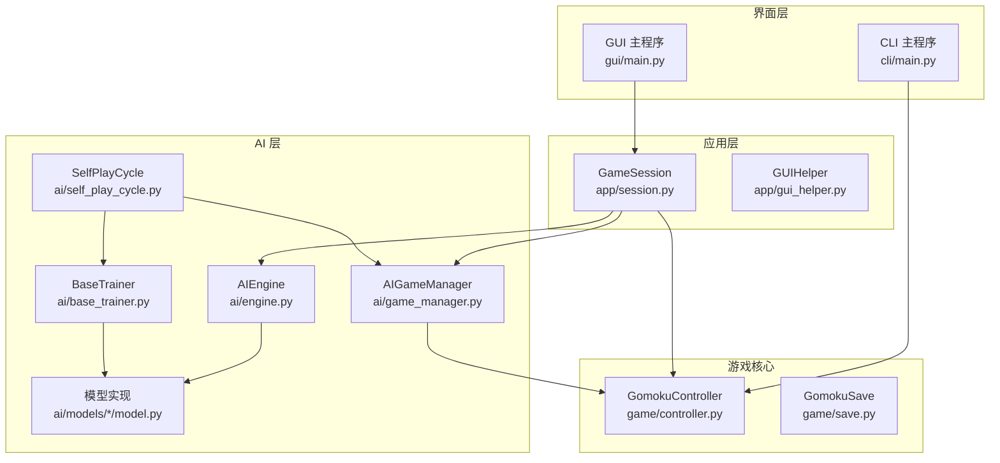
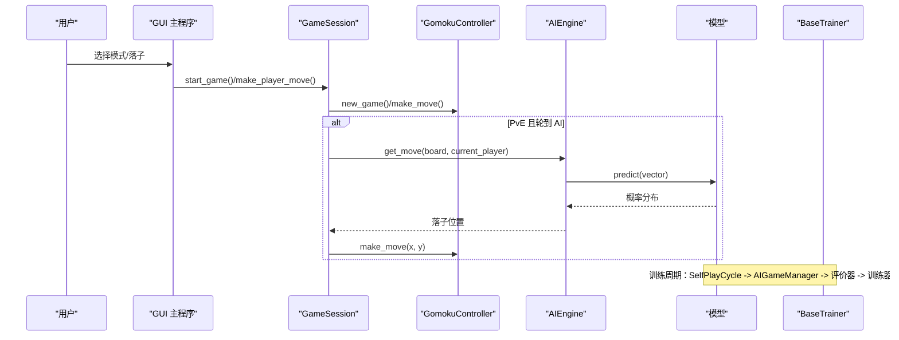
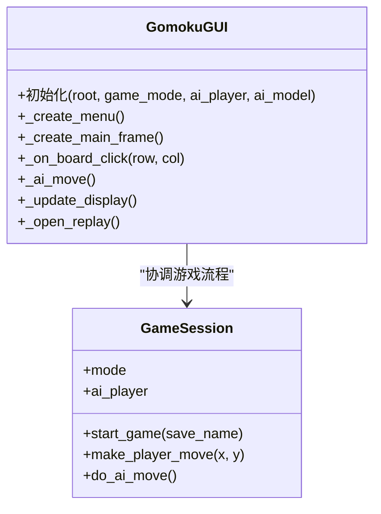
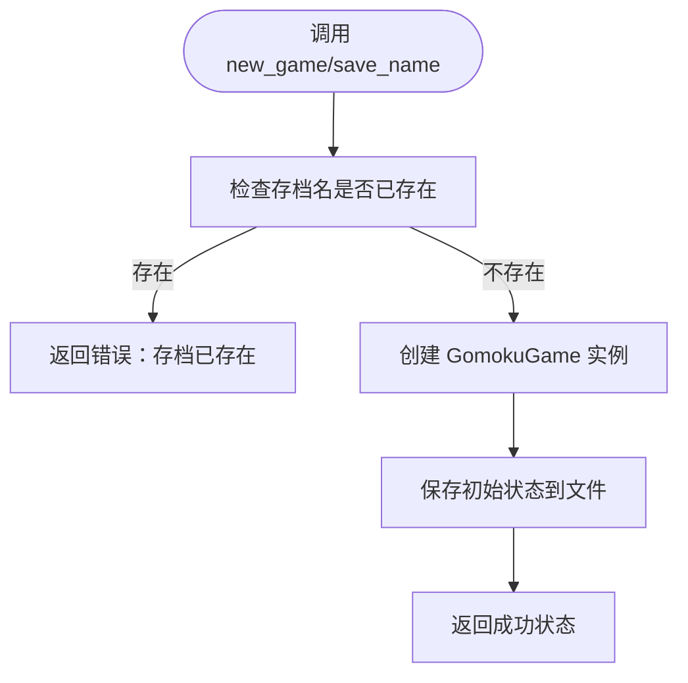
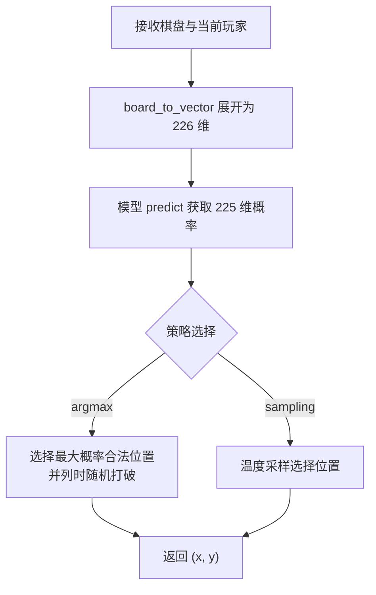
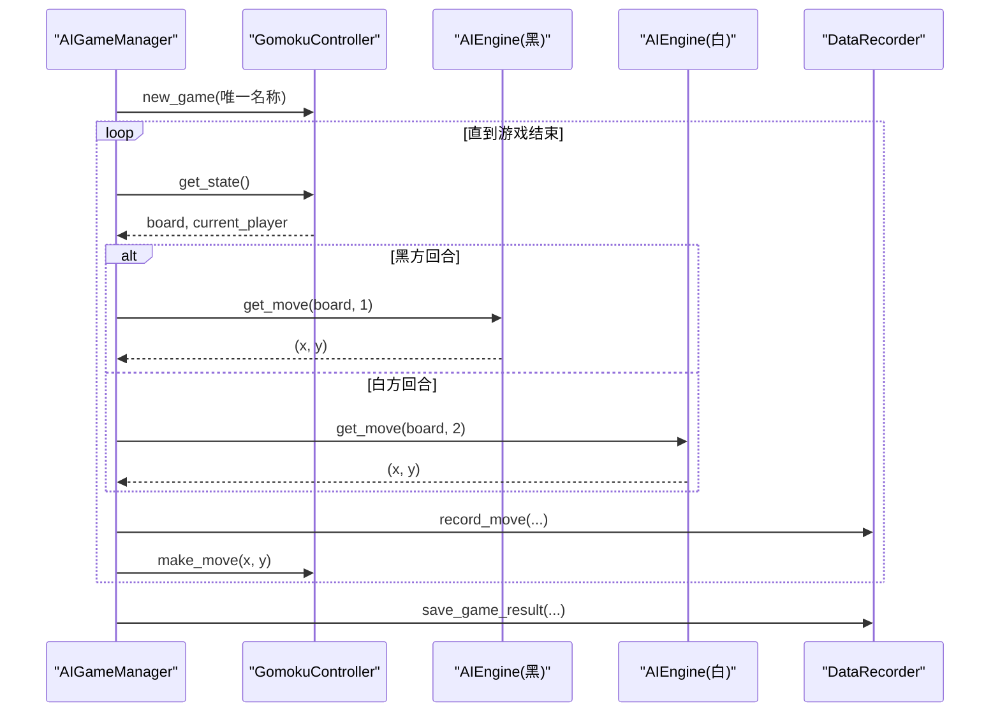
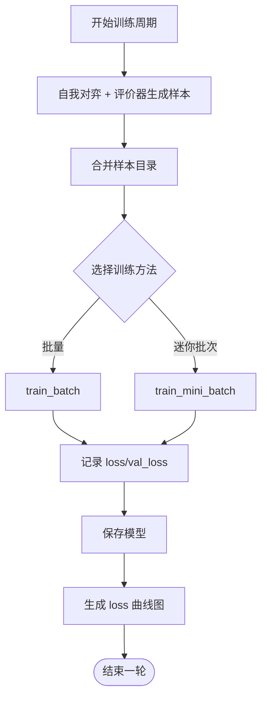
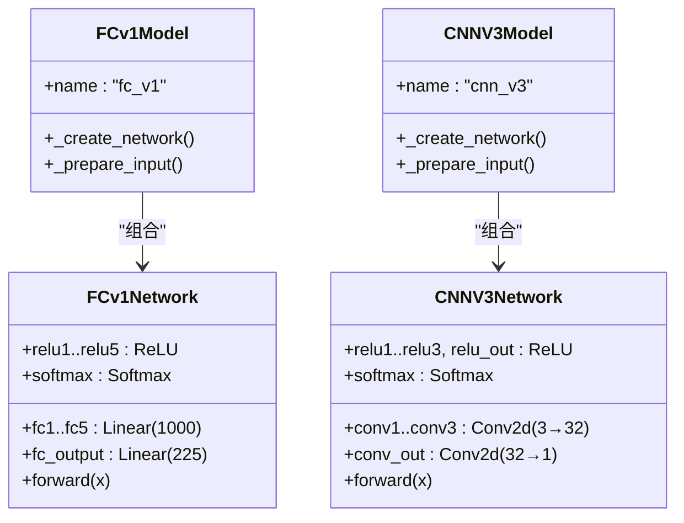
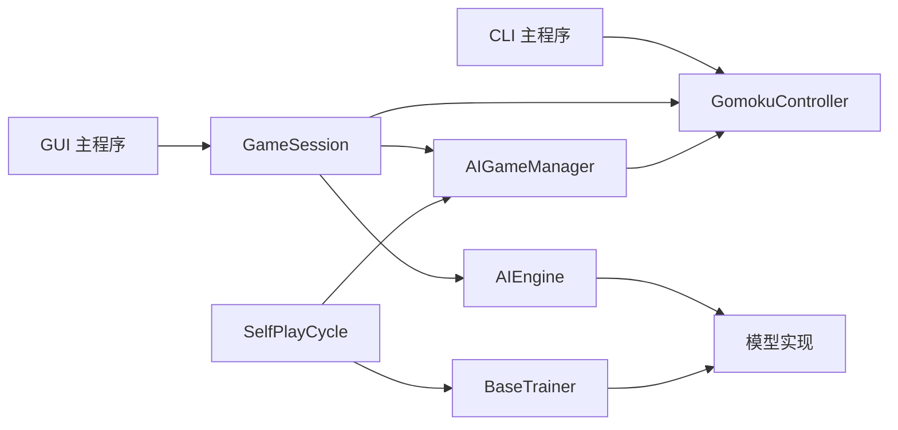

# 项目介绍

<cite>
**本文引用的文件**
- [README.md](file://README.md)
- [gui/main.py](file://gui/main.py)
- [cli/main.py](file://cli/main.py)
- [game/controller.py](file://game/controller.py)
- [ai/engine.py](file://ai/engine.py)
- [ai/game_manager.py](file://ai/game_manager.py)
- [ai/base_trainer.py](file://ai/base_trainer.py)
- [ai/self_play_cycle.py](file://ai/self_play_cycle.py)
- [ai/models/fc_v1/model.py](file://ai/models/fc_v1/model.py)
- [ai/models/cnn_v3/model.py](file://ai/models/cnn_v3/model.py)
- [app/session.py](file://app/session.py)
- [requirements/key_points.md](file://requirements/key_points.md)
</cite>

## 目录
1. [简介](#简介)
2. [项目结构](#项目结构)
3. [核心组件](#核心组件)
4. [架构总览](#架构总览)
5. [详细组件分析](#详细组件分析)
6. [依赖关系分析](#依赖关系分析)
7. [性能考量](#性能考量)
8. [故障排查指南](#故障排查指南)
9. [结论](#结论)
10. [附录](#附录)

## 简介
本项目是一个支持 AI 训练的五子棋游戏系统，目标是为教育、AI 研究与娱乐休闲提供一体化平台。项目围绕“可训练的五子棋”这一核心目标，构建了从 GUI/CLI 游戏界面、AI 引擎与模型、到自我对弈与训练流水线的完整闭环。用户既可直接体验 GUI/CLI 的人机对战与 AI 内战，也可通过命令行脚本生成训练样本、训练模型、进行多代模型演进与可视化分析。

项目愿景：
- 以“可训练”为核心，提供从数据采集、样本生成、模型训练到回放可视化的全链路能力；
- 以“多代模型”为特色，支持同一模型家族的多代权重演进与对比；
- 以“可复用”为目标，将热力图、评估器、训练器等模块化设计，便于扩展与维护。

## 项目结构
项目采用模块化分层组织，主要目录与职责如下：
- gui：图形界面，支持三种模式（PvP、PvE、AI vs AI），并提供回放与热力图对比；
- cli：命令行交互入口，支持存档管理、打印棋盘、落子等；
- game：游戏核心逻辑，提供控制器与存档管理；
- ai：AI 引擎、模型、训练器、数据记录与评估器、自我对弈与训练周期；
- app：应用层薄代理，协调 GUI 与游戏/AI 逻辑；
- requirements：需求与关键点文档；
- design：设计文档与优化计划；
- tests：全面的单元/集成/边缘测试；
- visualization：热力图颜色方案与可视化工具。

**图表来源**
- [gui/main.py:1-462](file://gui/main.py#L1-L462)
- [cli/main.py:1-258](file://cli/main.py#L1-L258)
- [app/session.py:1-179](file://app/session.py#L1-L179)
- [game/controller.py:1-194](file://game/controller.py#L1-L194)
- [ai/engine.py:1-194](file://ai/engine.py#L1-L194)
- [ai/game_manager.py:1-339](file://ai/game_manager.py#L1-L339)
- [ai/base_trainer.py:1-699](file://ai/base_trainer.py#L1-L699)
- [ai/self_play_cycle.py:1-195](file://ai/self_play_cycle.py#L1-L195)
- [ai/models/fc_v1/model.py:1-132](file://ai/models/fc_v1/model.py#L1-L132)
- [ai/models/cnn_v3/model.py:1-139](file://ai/models/cnn_v3/model.py#L1-L139)

**章节来源**
- [README.md:1-20](file://README.md#L1-L20)
- [requirements/key_points.md:1-100](file://requirements/key_points.md#L1-L100)

## 核心组件
- GUI 主程序：提供三种游戏模式、存档加载、AI 对战回放与热力图对比，界面友好、易于上手。
- CLI 主程序：提供命令行交互，适合自动化与批处理场景。
- 游戏控制器：统一对外接口，负责落子、状态查询、存档读写。
- AI 引擎：将棋盘状态转换为模型输入，调用模型获取概率分布，按策略选择落子位置。
- AI 游戏管理器：封装人机对战与 AI 内战流程，支持温度采样与执方随机。
- 训练器与训练周期：提供单轮/批量/迷你批次训练，支持学习率调度与验证集，支持自我对弈周期训练。
- 模型实现：包含 FC v1、CNN v1、CNN v2、CNN v3 等多代模型，满足不同复杂度与性能需求。

**章节来源**
- [gui/main.py:1-462](file://gui/main.py#L1-L462)
- [cli/main.py:1-258](file://cli/main.py#L1-L258)
- [game/controller.py:1-194](file://game/controller.py#L1-L194)
- [ai/engine.py:1-194](file://ai/engine.py#L1-L194)
- [ai/game_manager.py:1-339](file://ai/game_manager.py#L1-L339)
- [ai/base_trainer.py:1-699](file://ai/base_trainer.py#L1-L699)
- [ai/self_play_cycle.py:1-195](file://ai/self_play_cycle.py#L1-L195)
- [ai/models/fc_v1/model.py:1-132](file://ai/models/fc_v1/model.py#L1-L132)
- [ai/models/cnn_v3/model.py:1-139](file://ai/models/cnn_v3/model.py#L1-L139)

## 架构总览
系统采用“界面层 → 应用层 → 游戏核心 → AI 层”的分层架构，界面层通过应用层薄代理与游戏核心交互，AI 层通过引擎与模型交互，训练器与训练周期贯穿 AI 层，形成“对弈 → 评价 → 训练 → 演进”的闭环。

**图表来源**
- [gui/main.py:220-285](file://gui/main.py#L220-L285)
- [app/session.py:63-102](file://app/session.py#L63-L102)
- [game/controller.py:65-98](file://game/controller.py#L65-L98)
- [ai/engine.py:67-142](file://ai/engine.py#L67-L142)
- [ai/base_trainer.py:621-660](file://ai/base_trainer.py#L621-L660)

## 详细组件分析

### GUI 主程序与会话管理
- 支持三种模式：PvP、PvE、AI vs AI；提供存档加载、回放浏览与热力图对比。
- 会话层 GameSession 统一协调游戏流程，PvE 模式下与 AI 游戏管理器协作。
- 错误处理：捕获模型加载异常并提示用户回退。

**图表来源**
- [gui/main.py:31-462](file://gui/main.py#L31-L462)
- [app/session.py:12-179](file://app/session.py#L12-L179)

**章节来源**
- [gui/main.py:91-462](file://gui/main.py#L91-L462)
- [app/session.py:23-179](file://app/session.py#L23-L179)

### 游戏控制器与存档
- 统一对外接口：创建/加载/落子/状态查询/存档列表。
- 存档格式：JSON，包含棋盘、当前玩家、历史记录、获胜方等。
- 自动存档：游戏开始、结束、每次落子后均保存。

**图表来源**
- [game/controller.py:32-63](file://game/controller.py#L32-L63)

**章节来源**
- [game/controller.py:11-194](file://game/controller.py#L11-L194)
- [requirements/key_points.md:16-71](file://requirements/key_points.md#L16-L71)

### AI 引擎与落子策略
- 输入：226 维向量（棋盘按行优先 + 当前玩家）。
- 输出：225 维概率分布（Softmax）。
- 落子策略：默认 argmax（并列最大值随机打破），或温度采样（委托 move_sampler）。

**图表来源**
- [ai/engine.py:67-142](file://ai/engine.py#L67-L142)

**章节来源**
- [ai/engine.py:18-194](file://ai/engine.py#L18-L194)

### AI 游戏管理器与自我对弈
- 人机对战：玩家落子后自动触发 AI 落子。
- AI 内战：支持固定执方与随机执方两种模式，支持温度采样配置。
- 数据记录：每步记录输入、输出、落子位置，保存游戏结果。

**图表来源**
- [ai/game_manager.py:123-230](file://ai/game_manager.py#L123-L230)
- [ai/game_manager.py:232-339](file://ai/game_manager.py#L232-L339)

**章节来源**
- [ai/game_manager.py:16-339](file://ai/game_manager.py#L16-L339)

### 训练器与训练周期
- 支持单轮/批量/迷你批次训练，自动检测 GPU 并使用 AdamW 优化器。
- 训练周期：自我对弈 → 评价器生成样本 → 合并样本 → 训练 → 保存模型 → 绘制 loss 曲线。
- 支持学习率调度（StepLR/ReduceLROnPlateau）与验证集监控。

**图表来源**
- [ai/self_play_cycle.py:38-195](file://ai/self_play_cycle.py#L38-L195)
- [ai/base_trainer.py:324-699](file://ai/base_trainer.py#L324-L699)

**章节来源**
- [ai/self_play_cycle.py:20-195](file://ai/self_play_cycle.py#L20-L195)
- [ai/base_trainer.py:32-120](file://ai/base_trainer.py#L32-L120)

### 模型实现（FC v1 与 CNN v3）
- FC v1：5 层隐藏层（每层 1000），输出层 + Softmax，输入为 226 维向量。
- CNN v3：纯卷积网络（无 FC/BatchNorm/Dropout），1×1 卷积替代 FC，输入为 3×15×15，参数量极低。

**图表来源**
- [ai/models/fc_v1/model.py:18-132](file://ai/models/fc_v1/model.py#L18-L132)
- [ai/models/cnn_v3/model.py:31-139](file://ai/models/cnn_v3/model.py#L31-L139)

**章节来源**
- [ai/models/fc_v1/model.py:1-132](file://ai/models/fc_v1/model.py#L1-L132)
- [ai/models/cnn_v3/model.py:1-139](file://ai/models/cnn_v3/model.py#L1-L139)

### 命令行与快速开始
- GUI/CLI 启动方式、AI 对战、样本生成、训练、LR 范围测试等命令行工具。
- 支持多代模型加载（如 cnn_v3.1、cnn_v3.2）与温度采样配置。

**章节来源**
- [README.md:40-197](file://README.md#L40-L197)
- [cli/main.py:19-258](file://cli/main.py#L19-L258)

## 依赖关系分析
- 界面层依赖应用层与游戏核心；应用层依赖游戏核心与 AI 层；
- AI 层内部通过引擎与模型解耦，训练器与训练周期相互协作；
- 模块间通过清晰的接口与常量（如数据目录）解耦，降低耦合度。

**图表来源**
- [gui/main.py:18-28](file://gui/main.py#L18-L28)
- [app/session.py:7-9](file://app/session.py#L7-L9)
- [ai/engine.py:8-41](file://ai/engine.py#L8-L41)
- [ai/game_manager.py:8-13](file://ai/game_manager.py#L8-L13)
- [ai/base_trainer.py:14-18](file://ai/base_trainer.py#L14-L18)
- [ai/self_play_cycle.py:12-14](file://ai/self_play_cycle.py#L12-L14)

**章节来源**
- [requirements/key_points.md:104-131](file://requirements/key_points.md#L104-L131)

## 性能考量
- GPU 加速：训练器自动检测并使用 CUDA 设备；
- 训练模式选择：批量训练适合中小规模数据，迷你批次训练收敛更快；
- 学习率调度：StepLR/ReduceLROnPlateau 有助于稳定训练；
- 数据增强：样本生成支持 D4 群对称变换，提升数据多样性；
- 可观测性：密集 loss 日志与曲线图，便于诊断收敛与梯度问题。

[本节为通用指导，无需特定文件引用]

## 故障排查指南
- 模型加载失败：GUI/PvE 模式下捕获模型加载异常并提示用户回退；
- 游戏状态异常：检查控制器状态与存档完整性；
- 训练中断：支持 Ctrl+C 优雅退出，自动保存模型与图表；
- 温度采样问题：确认采样参数（温度、前 N 步、作用方）配置正确。

**章节来源**
- [gui/main.py:418-456](file://gui/main.py#L418-L456)
- [app/session.py:44-51](file://app/session.py#L44-L51)
- [ai/base_trainer.py:314-322](file://ai/base_trainer.py#L314-L322)

## 结论
本项目以“可训练的五子棋”为核心，构建了从 GUI/CLI 到 AI 引擎、模型、训练器与训练周期的完整体系。其特色在于：
- GUI/CLI 双入口，覆盖教学、研究与娱乐；
- 自我对弈与多代模型支持，便于持续演进；
- 模块化设计与丰富的可观测性，便于扩展与维护。

目标用户：
- 教育：学生与教师用于教学演示与实验；
- AI 研究：研究人员用于算法验证与模型对比；
- 娱乐休闲：普通用户享受人机对战与 AI 内战。

[本节为总结，无需特定文件引用]

## 附录
- 开源协议：MIT License
- 贡献方式：欢迎提交 Issue 与 PR，遵循项目设计文档与测试规范；
- 社区支持：通过 GitHub Issues 获取帮助与反馈。

**章节来源**
- [README.md:419-422](file://README.md#L419-L422)