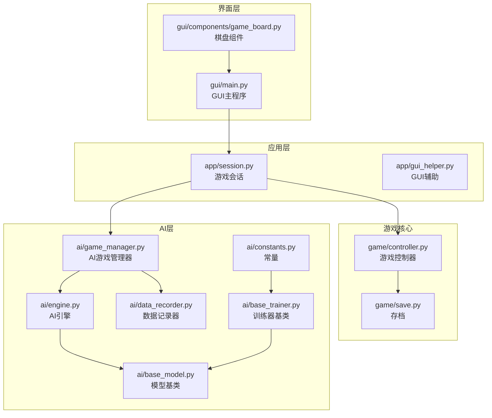
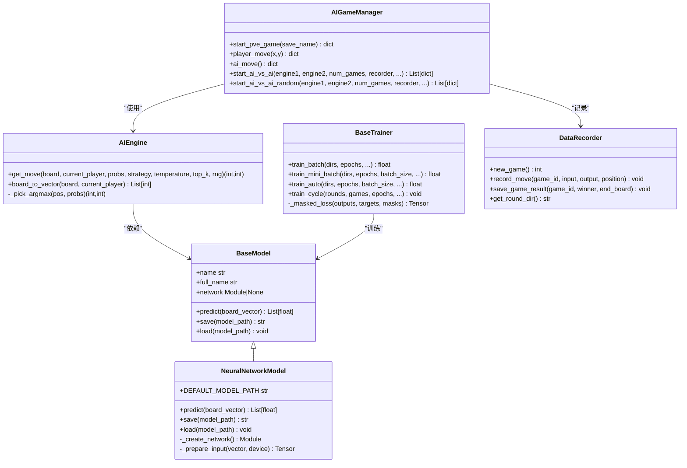
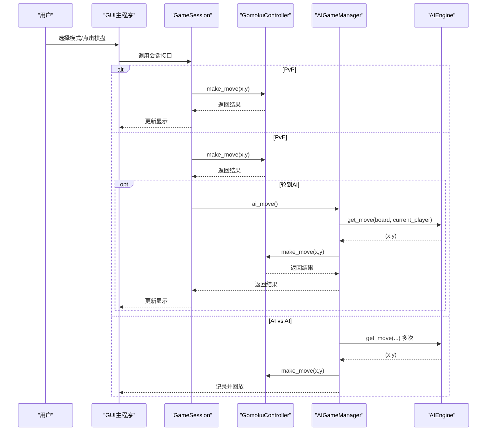
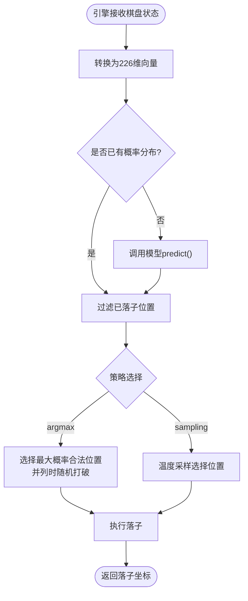
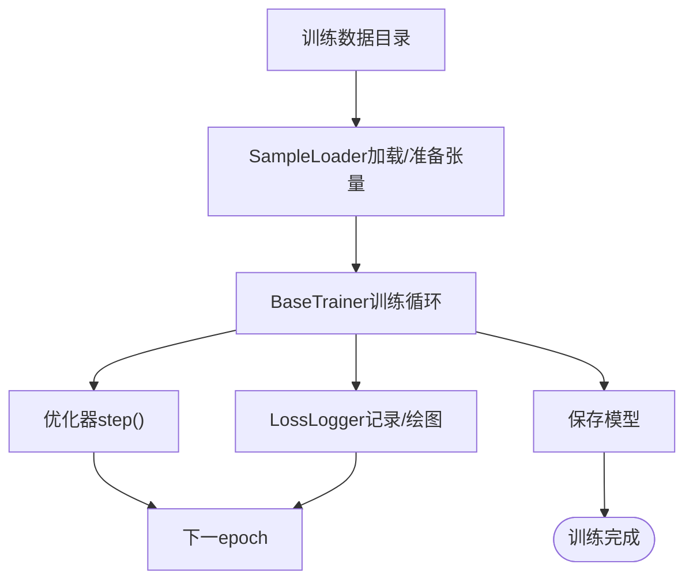
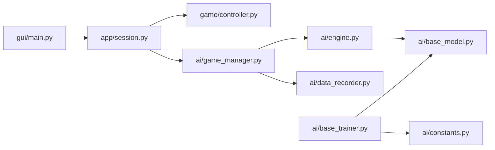

# 项目概述

<cite>
**本文档引用的文件**
- [README.md](file://README.md)
- [gui/main.py](file://gui/main.py)
- [game/controller.py](file://game/controller.py)
- [ai/engine.py](file://ai/engine.py)
- [ai/game_manager.py](file://ai/game_manager.py)
- [ai/base_model.py](file://ai/base_model.py)
- [ai/base_trainer.py](file://ai/base_trainer.py)
- [ai/data_recorder.py](file://ai/data_recorder.py)
- [ai/constants.py](file://ai/constants.py)
- [app/session.py](file://app/session.py)
- [gui/components/game_board.py](file://gui/components/game_board.py)
- [requirements/key_points.md](file://requirements/key_points.md)
</cite>

## 目录
1. [简介](#简介)
2. [项目结构](#项目结构)
3. [核心组件](#核心组件)
4. [架构总览](#架构总览)
5. [详细组件分析](#详细组件分析)
6. [依赖关系分析](#依赖关系分析)
7. [性能考量](#性能考量)
8. [故障排查指南](#故障排查指南)
9. [结论](#结论)
10. [附录](#附录)

## 简介
本项目是一个支持 AI 训练的五子棋游戏系统，提供图形界面（GUI）与命令行界面（CLI），内置多种 AI 模型（Random、FCv1、CNNV1/V2/V3），并具备完整的 AI 对战与自我对弈训练流水线。项目强调模块化与可扩展性：游戏逻辑与 AI 逻辑分离，AI 引擎与模型解耦，训练器抽象统一，支持 PvP（人人对战）、PvE（人机对战）与 AI vs AI（AI 内战）三种模式。

## 项目结构
项目采用分层与功能域划分相结合的组织方式：
- gui：图形界面入口与组件，负责用户交互与显示更新
- game：核心游戏逻辑（控制器、存档、胜负判定）
- ai：AI 引擎、模型、训练器、数据记录与评估
- app：应用层薄代理（会话管理、GUI 辅助、异常桥接）
- cli：命令行交互入口
- requirements：需求与设计要点文档
- design/temp/coverage_report：设计文档、临时分析脚本与覆盖率报告

**图表来源**
- [gui/main.py:1-462](file://gui/main.py#L1-L462)
- [app/session.py:1-179](file://app/session.py#L1-L179)
- [game/controller.py:1-194](file://game/controller.py#L1-L194)
- [ai/engine.py:1-194](file://ai/engine.py#L1-L194)
- [ai/game_manager.py:1-339](file://ai/game_manager.py#L1-L339)
- [ai/data_recorder.py:1-145](file://ai/data_recorder.py#L1-L145)
- [ai/base_trainer.py:1-699](file://ai/base_trainer.py#L1-L699)
- [ai/base_model.py:1-323](file://ai/base_model.py#L1-L323)
- [ai/constants.py:1-26](file://ai/constants.py#L1-L26)

**章节来源**
- [README.md:5-20](file://README.md#L5-L20)
- [gui/main.py:1-462](file://gui/main.py#L1-L462)
- [app/session.py:1-179](file://app/session.py#L1-L179)
- [game/controller.py:1-194](file://game/controller.py#L1-L194)
- [ai/engine.py:1-194](file://ai/engine.py#L1-L194)
- [ai/game_manager.py:1-339](file://ai/game_manager.py#L1-L339)
- [ai/data_recorder.py:1-145](file://ai/data_recorder.py#L1-L145)
- [ai/base_trainer.py:1-699](file://ai/base_trainer.py#L1-L699)
- [ai/base_model.py:1-323](file://ai/base_model.py#L1-L323)
- [ai/constants.py:1-26](file://ai/constants.py#L1-L26)

## 核心组件
- GUI 主程序与组件：提供三种游戏模式入口、棋盘绘制与交互、回放浏览与回放窗口
- 游戏控制器：封装棋盘状态、落子合法性检查、胜负判定与存档读写
- AI 引擎：将棋盘状态转换为模型输入，调用模型输出概率分布，按策略选择落子
- AI 游戏管理器：协调 PvE 与 AI vs AI 流程，驱动引擎执行落子并记录数据
- 模型基类与具体模型：Random、FCv1、CNNV1/V2/V3，统一接口与 PyTorch 抽象
- 训练器基类：统一训练流程、设备选择、损失计算、学习率调度与日志输出
- 数据记录器：记录每步输入输出与落子位置，生成对局记录文件
- 常量模块：统一管理 AI 数据与训练数据目录、日志间隔等

**章节来源**
- [gui/main.py:31-462](file://gui/main.py#L31-L462)
- [gui/components/game_board.py:1-170](file://gui/components/game_board.py#L1-L170)
- [game/controller.py:11-194](file://game/controller.py#L11-L194)
- [ai/engine.py:44-194](file://ai/engine.py#L44-L194)
- [ai/game_manager.py:16-339](file://ai/game_manager.py#L16-L339)
- [ai/base_model.py:24-323](file://ai/base_model.py#L24-L323)
- [ai/base_trainer.py:32-699](file://ai/base_trainer.py#L32-L699)
- [ai/data_recorder.py:17-145](file://ai/data_recorder.py#L17-L145)
- [ai/constants.py:8-26](file://ai/constants.py#L8-L26)

## 架构总览
系统采用“界面层-应用层-游戏核心-AI层”的分层架构，遵循以下设计原则：
- 游戏逻辑与 AI 逻辑分离：game 包不依赖 ai 包，ai 包也不依赖 game 包
- 引擎与模型解耦：AIEngine 仅依赖 BaseModel 接口，具体模型可替换
- 训练器抽象统一：BaseTrainer 提供训练流程、设备与日志统一能力
- 会话与控制器协作：app 层的 GameSession 协调 GUI 与游戏/AI 流程

**图表来源**
- [ai/base_model.py:24-323](file://ai/base_model.py#L24-L323)
- [ai/engine.py:44-194](file://ai/engine.py#L44-L194)
- [ai/game_manager.py:16-339](file://ai/game_manager.py#L16-L339)
- [ai/base_trainer.py:32-699](file://ai/base_trainer.py#L32-L699)
- [ai/data_recorder.py:17-145](file://ai/data_recorder.py#L17-L145)

## 详细组件分析

### GUI 与会话（PvP/PvE/AI vs AI）
- GUI 主程序负责模式选择、菜单与控制按钮、棋盘绘制与点击响应、回放浏览与回放窗口
- GameSession 将 GUI 与游戏/AI 流程解耦：PvP 直接调用控制器，PvE 通过 AIGameManager 协调 AI 落子
- 模式特性：
  - PvP：双人轮流落子，无 AI 参与
  - PvE：玩家选择执黑/执白，AI 引擎自动落子
  - AI vs AI：双方 AI 自动对战，记录数据并可回放

**图表来源**
- [gui/main.py:224-268](file://gui/main.py#L224-L268)
- [app/session.py:63-179](file://app/session.py#L63-L179)
- [game/controller.py:65-121](file://game/controller.py#L65-L121)
- [ai/game_manager.py:100-122](file://ai/game_manager.py#L100-L122)
- [ai/engine.py:67-143](file://ai/engine.py#L67-L143)

**章节来源**
- [gui/main.py:31-462](file://gui/main.py#L31-L462)
- [app/session.py:12-179](file://app/session.py#L12-L179)
- [game/controller.py:11-194](file://game/controller.py#L11-L194)
- [ai/game_manager.py:16-339](file://ai/game_manager.py#L16-L339)
- [ai/engine.py:44-194](file://ai/engine.py#L44-L194)

### AI 引擎与模型
- AIEngine 负责输入向量转换、模型预测与落子策略（argmax/sampling），支持传入预计算概率以提升性能
- BaseModel 定义统一接口；NeuralNetworkModel 提供 PyTorch 通用实现（前向、保存/加载、设备移动）
- 支持的模型：
  - Random：均匀分布随机落子
  - FCv1：全连接网络，输出 225 维 Softmax 概率
  - CNNV1/V2/V3：卷积网络，输入为 15×15×3 张量，输出 225 维 Softmax 概率

**图表来源**
- [ai/engine.py:67-194](file://ai/engine.py#L67-L194)
- [ai/base_model.py:195-231](file://ai/base_model.py#L195-L231)

**章节来源**
- [ai/engine.py:44-194](file://ai/engine.py#L44-L194)
- [ai/base_model.py:24-323](file://ai/base_model.py#L24-L323)

### 训练系统与数据管线
- BaseTrainer 提供统一训练流程：单轮次训练、批量训练、mini-batch 训练、训练周期
- 支持 GPU 自动检测与加速，L1 损失结合 mask，支持学习率调度与密集/稀疏日志
- DataRecorder 记录每步 input/output/position，生成对局记录文件，支持 AI vs AI 数据采集
- 训练数据目录与常量统一管理，日志间隔可配置

**图表来源**
- [ai/base_trainer.py:257-323](file://ai/base_trainer.py#L257-L323)
- [ai/base_trainer.py:409-574](file://ai/base_trainer.py#L409-L574)
- [ai/data_recorder.py:66-145](file://ai/data_recorder.py#L66-L145)
- [ai/constants.py:11-26](file://ai/constants.py#L11-L26)

**章节来源**
- [ai/base_trainer.py:32-699](file://ai/base_trainer.py#L32-L699)
- [ai/data_recorder.py:17-145](file://ai/data_recorder.py#L17-L145)
- [ai/constants.py:8-26](file://ai/constants.py#L8-L26)

### 游戏逻辑与存档
- GomokuController 封装游戏状态、落子合法性、胜负判定与存档读写
- 存档格式 JSON，包含名称、开始时间、棋盘、当前玩家、历史记录与获胜方
- 支持默认存档命名与自动保存

**章节来源**
- [game/controller.py:11-194](file://game/controller.py#L11-L194)
- [requirements/key_points.md:16-71](file://requirements/key_points.md#L16-L71)

### GUI 组件与回放
- GameBoard 负责棋盘绘制、星位标记与最后落子高亮
- GUI 主程序提供模式选择、菜单、控制按钮与回放浏览
- 回放窗口支持逐步查看、跳转结局、重置与热力图对比

**章节来源**
- [gui/components/game_board.py:1-170](file://gui/components/game_board.py#L1-L170)
- [gui/main.py:91-462](file://gui/main.py#L91-L462)

## 依赖关系分析
- 外部依赖：PyTorch（AI 模型与训练）、NumPy（训练数据处理）、Matplotlib（训练曲线）、tkinter（GUI）
- 内部模块耦合：
  - GUI 依赖 app 会话与组件
  - app 会话依赖 game 控制器与 ai 管理器
  - ai 管理器依赖 ai 引擎与数据记录器
  - ai 引擎依赖模型基类
  - 训练器依赖模型基类与常量模块

**图表来源**
- [gui/main.py:18-28](file://gui/main.py#L18-L28)
- [app/session.py:7-9](file://app/session.py#L7-L9)
- [ai/game_manager.py:10-13](file://ai/game_manager.py#L10-L13)
- [ai/engine.py:9](file://ai/engine.py#L9)
- [ai/base_trainer.py:14-18](file://ai/base_trainer.py#L14-L18)
- [ai/constants.py:8-22](file://ai/constants.py#L8-L22)

**章节来源**
- [gui/main.py:18-28](file://gui/main.py#L18-L28)
- [app/session.py:7-9](file://app/session.py#L7-L9)
- [ai/game_manager.py:10-13](file://ai/game_manager.py#L10-L13)
- [ai/engine.py:9](file://ai/engine.py#L9)
- [ai/base_trainer.py:14-18](file://ai/base_trainer.py#L14-L18)
- [ai/constants.py:8-22](file://ai/constants.py#L8-L22)

## 性能考量
- 设备自动检测：优先使用 GPU，训练器自动将模型与张量移动到同一设备
- mini-batch 训练：支持批内多次前向/反向传播，显著提升吞吐与收敛速度
- 密集日志：mini-batch 模式下记录每个 batch 的 loss 与梯度范数，便于诊断
- 学习率调度：StepLR 与 ReduceLROnPlateau 可选，降低后期训练难度
- 输入转换优化：CNN 模型共享输入转换逻辑，避免重复计算

**章节来源**
- [ai/base_trainer.py:21-29](file://ai/base_trainer.py#L21-L29)
- [ai/base_trainer.py:409-574](file://ai/base_trainer.py#L409-L574)
- [ai/base_model.py:278-323](file://ai/base_model.py#L278-L323)

## 故障排查指南
- 模型加载失败：GUI 层捕获模型加载异常并提示用户，回退到模式选择
- 训练中断：支持 Ctrl+C 优雅退出，自动保存模型与图表
- 训练无进展：检查学习率调度与 batch size，必要时启用验证集监控
- 数据路径问题：确认 AI 数据与训练数据目录常量配置正确

**章节来源**
- [app/session.py:44-51](file://app/session.py#L44-L51)
- [ai/base_trainer.py:314-322](file://ai/base_trainer.py#L314-L322)
- [ai/constants.py:11-26](file://ai/constants.py#L11-L26)

## 结论
本项目以清晰的分层架构实现了五子棋游戏与 AI 训练的完整闭环：GUI/CLI 提供友好的交互入口，game 包专注规则与存档，ai 包提供可插拔的模型与训练器，app 层承担薄代理职责。系统支持多样化的游戏模式与 AI 模型，具备完善的训练与回放能力，适合初学者入门与高级开发者扩展。

## 附录
- 技术栈概览：Python、PyTorch、NumPy、Matplotlib、tkinter
- 模式与用途：
  - PvP：教学与休闲对弈
  - PvE：体验不同 AI 强度与策略
  - AI vs AI：研究与对比不同模型表现
- AI 模型多样性：Random（基线）、FCv1（全连接）、CNNV1/V2/V3（卷积网络，参数量逐代递减）
- 训练系统完整性：数据采集（自我对弈）、数据增强、样本合并、训练（单轮/周期/mini-batch）、日志与可视化、学习率调度

**章节来源**
- [README.md:24-34](file://README.md#L24-L34)
- [README.md:47-74](file://README.md#L47-L74)
- [README.md:363-404](file://README.md#L363-L404)
- [README.md:115-197](file://README.md#L115-L197)