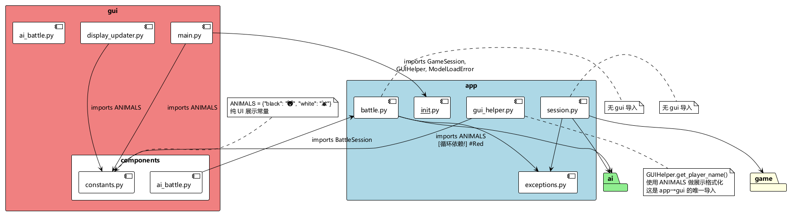
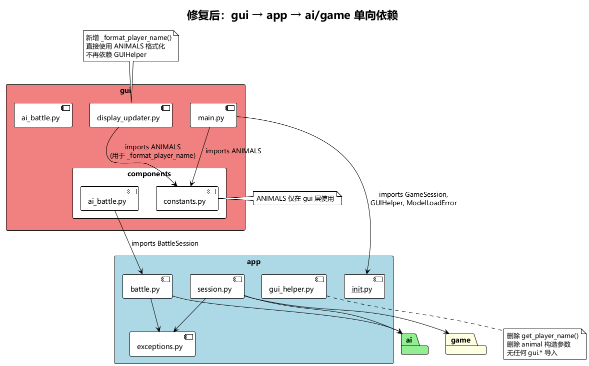

# app ↔ gui 循环依赖分析与解决方案

## 1. 问题描述

`app` 包与 `gui` 包之间存在循环依赖，违反了架构设计中 `gui → app → ai/game` 的单向依赖原则。

根据 [app_design.md](../app_design.md)，`app` 包的定位是位于 `ai`/`game` 包之上、`gui` 包之下的薄代理层。`app` 不应依赖 `gui`，但目前存在反向依赖。

## 2. 依赖关系分析

### 2.1 当前依赖图



详见：[dependency_graph.puml](dependency_graph.puml)

### 2.2 正向依赖（gui → app，符合架构）

| 文件 | 导入内容 | 用途 |
|------|---------|------|
| `gui/main.py` | `from app import GameSession, GUIHelper, get_ai_data_dir, create_pve_config` | PvE/PvP 游戏流程 |
| `gui/main.py` | `from app.exceptions import ModelLoadError` | 捕获模型加载异常并弹窗 |
| `gui/components/ai_battle.py` | `from app import BattleSession` | AI 内战流程 |
| `gui/components/ai_battle.py` | `from app.exceptions import ModelLoadError` | 捕获模型加载异常并弹窗 |

### 2.3 反向依赖（app → gui，违反架构循环依赖根因）

| 文件 | 导入内容 | 用途 |
|------|---------|------|
| `app/gui_helper.py` | `from gui.components.constants import ANIMALS` | `GUIHelper.get_player_name()` 格式化玩家名称 |

**这是 `app` → `gui` 唯一的导入**，导致了整个循环依赖。

### 2.4 ANIMALS 常量分析

```python
# gui/components/constants.py
ANIMALS = {
    "black": "🐻",     # 小熊 emoji
    "white": "🐰",     # 小兔 emoji
    "last_move": "🐾", # 脚印 emoji
}
```

`ANIMALS` 是纯 UI 展示常量（Unicode 表情符号），用于界面显示。在 `app/gui_helper.py` 中的使用：

```python
# app/gui_helper.py 第 160-163 行
def get_player_name(self, player: int, winner: int = 0) -> str:
    if player == 1:
        return f"小熊 {ANIMALS['black']}"   # → "小熊 🐻"
    else:
        return f"小兔 {ANIMALS['white']}"   # → "小兔 🐰"
```

### 2.5 app 包内其他文件无 gui 依赖

确认 `app/session.py`、`app/battle.py`、`app/exceptions.py` 均无任何 `gui` 包的导入，只有 `gui_helper.py` 引入了循环依赖。

## 3. 解决方案

### 3.1 方案对比

| 方案 | 描述 | 改动量 | 架构纯净度 | 推荐 |
|------|------|--------|-----------|------|
| **A: 构造函数注入** | GUIHelper 通过构造函数接收 animal 字符串 | 小 | ★★★ | ✅ |
| B: 移除 ANIMALS 硬编码 | GUIHelper 直接硬编码 emoji 字符 | 最小 | ★★☆ | 备选 |
| C: 新建共享常量模块 | 提取 ANIMALS 到 src 级别共享模块 | 中 | ★★☆ | ❌ |

### 3.2 最终方案：将 `get_player_name` 移到 GUI 层（方案 D）

**核心思路**：`get_player_name` 是纯 GUI 展示方法（格式化含 emoji 的玩家名用于 tkinter Label），仅被 `display_updater.py` 调用，不涉及持久化。将其从 `app` 层移除，内联到 `gui/display_updater.py` 中，`GUIHelper` 恢复为纯粹的"与界面无关的业务逻辑"代理。

**修改点：**

#### ① `app/gui_helper.py`

- **删除**：`get_player_name` 方法（含 `black_animal`/`white_animal` 构造参数）
- **恢复**：构造函数为 `__init__(self, controller, session)`
- 该模块再无任何 `gui.*` 导入

#### ② `gui/display_updater.py`

- **新增**：`@staticmethod _format_player_name(player, winner=0)`，使用 `ANIMALS` 常量直接格式化
- **替换**：`self.helper.get_player_name(...)` → `self._format_player_name(...)`
- **删除**：`helper` 构造参数（display_updater 不再依赖 GUIHelper）

#### ③ `gui/main.py`

- **恢复**：`GUIHelper(self.controller, self.session)`（不再传入 animal 参数）
- **删除**：`GameDisplayUpdater(... helper=self.helper ...)` 中的 `helper` 参数

### 3.3 修改后依赖关系



详见：[dependency_graph_after.puml](dependency_graph_after.puml)

```
┌─────────────────────────────────────────┐
│              gui 包                      │  上层（纯 UI）
│  ANIMALS 常量仅 GUI 层使用               │
│  _format_player_name 内联在 display 中   │
└────────────────┬────────────────────────┘
                 │ 单向依赖（无反向）
┌────────────────▼────────────────────────┐
│              app 包                      │  应用层（薄代理）
│  GUIHelper 仅含业务逻辑代理              │
│  无任何 gui.* 导入                        │
└──────┬───────────────────┬─────────────┘
       │                   │
┌──────▼──────┐    ┌───────▼─────────────┐
│   ai 包     │    │     game 包          │
└─────────────┘    └─────────────────────┘
```

循环依赖完全消除，且不再有`gui → app → gui` 的迂回调用——display_updater 直接在自己内部完成玩家名格式化。

## 4. 影响范围

| 文件 | 变更类型 | 说明 |
|------|---------|------|
| `app/gui_helper.py` | 修改 | 删除 `get_player_name` 方法和 animal 参数，恢复简洁构造函数 |
| `gui/display_updater.py` | 修改 | 新增 `_format_player_name` 静态方法，移除 `helper` 构造参数 |
| `gui/main.py` | 修改 | 恢复 `GUIHelper(controller, session)` 简洁调用，移除 `display_updater` 的 `helper` 参数 |

## 5. 验证方法

修改完成后，运行以下命令验证循环依赖已消除：

```bash
# 检查 app 包中不再有 gui 的导入
rg "from gui|import gui" src/app/

# 应返回空结果
```

同时运行现有测试确保无回归：

```bash
python -m pytest tests/ -x -q
# 结果: 1659 passed, 3 skipped, 0 failed ✅
```

## 6. 设计决策说明

**为什么不采用构造函数注入（初始方案）**：虽然注入打破了循环依赖，但 `get_player_name` 是纯 UI 展示方法（仅用于 tkinter Label 文本），不涉及持久化。注入后形成 `gui → app → gui` 的迂回调用——gui 注入展示常量到 app，又从 app 取回来用。这多此一举。

**最终方案的优势**：将 `get_player_name` 移到它唯一的调用者 `display_updater.py` 中，`GUIHelper` 真正成为"与界面无关的业务逻辑"代理，职责更清晰。
