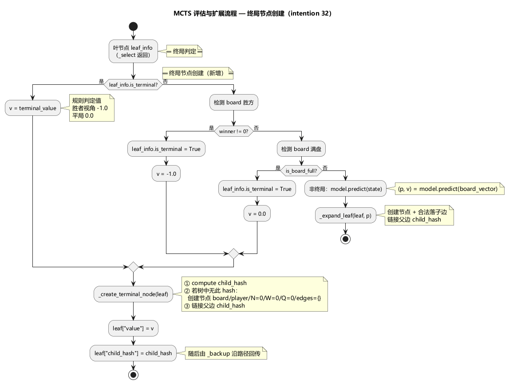
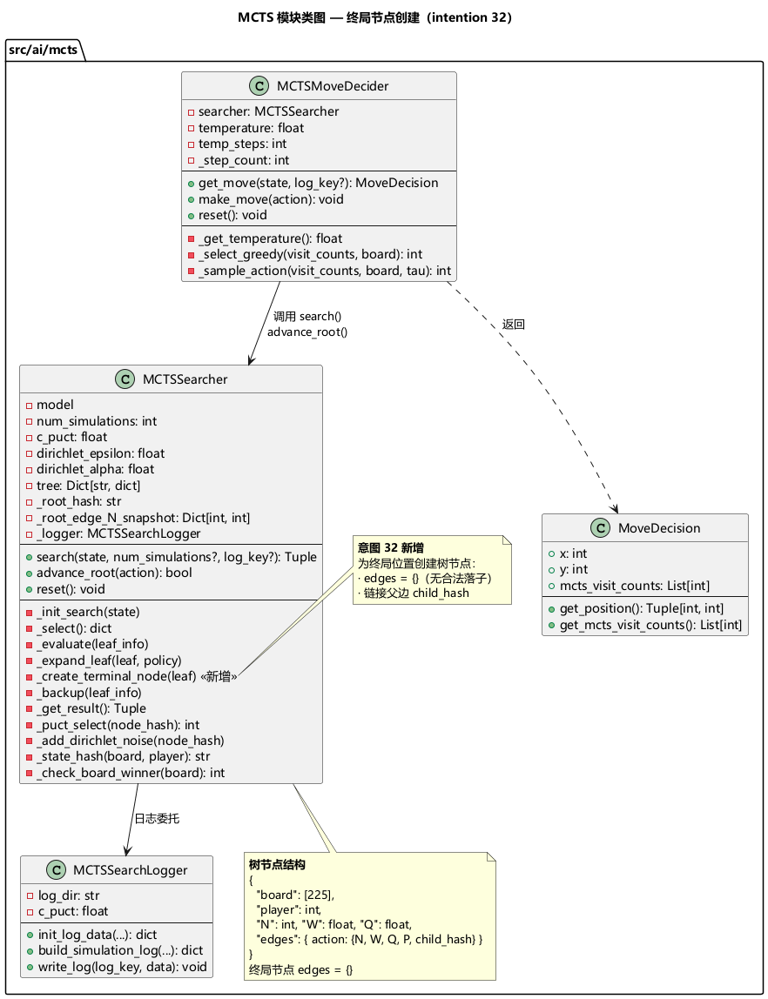

# 设计文档-32：MCTS 终局节点创建与子树推进修复

> 意图 32 | 日期：2026-06-28 | 关联模块：src/ai/mcts/searcher.py

---

## 1. 概述

修复 `MCTSSearcher` 中终局节点未入树导致 `advance_root()` 失败的缺陷。当前 `_evaluate()` 在检测到终局（获胜/平局）时直接返回，不创建树节点、不设置父边 `child_hash`，导致 `advance_root()` 对该边返回 `False`。

### 动机

终局位置是有意义的游戏状态，应存在于搜索树中：
1. `advance_root()` 依赖 `child_hash` 定位子节点，终局节点缺失会导致异常
2. 子树复用要求所有可达状态都在树中有对应节点
3. 消除调用方需预判终局才能调用 `make_move` 的脆弱性

---

## 2. 当前缺陷（变更前）

### 2.1 `_evaluate()` 终局处理

`_evaluate()` 有三处终局早返回，均未创建树节点：

| 终局判定路径 | 代码位置 | 行为 |
|-------------|---------|------|
| `_make_terminal_leaf` 设置 `is_terminal=True` | L401-403 | 设 value，直接 return |
| `_check_board_winner` 检测到胜方 | L406-412 | 设 is_terminal/value，直接 return |
| `is_board_full` 检测到满棋盘 | L413-416 | 设 is_terminal/value，直接 return |

### 2.2 `advance_root()` 的依赖链

```
advance_root(action)
  → root["edges"][action]["child_hash"]  ← 此处为 None 时返回 False
  → child_hash not in self.tree          ← 终局节点从未入树
  → RuntimeError
```

### 2.3 当前自对弈的绕行方案

`mcts_self_play.py` 在调用 `decider.make_move()` 前先检查终局，绕开了缺陷。但这是调用方补救，树本身不完整。

```python
# mcts_self_play.py L200-211
if is_terminal:
    decider.reset()      # 绕开 make_move
else:
    decider.make_move(action)  # 依赖 advance_root
```

---

## 3. 目标状态（变更后）

### 3.1 终局节点处理流程

```
_evaluate(leaf):
  ├─ 判定终局（三路径任一命中）
  │   └─ 设 leaf["value"] = 规则判定值
  │   └─ _create_terminal_node(leaf)  ← 新增
  │       ├─ 计算 child_hash
  │       ├─ 若树中无此节点：创建节点（edges={}，无合法落子）
  │       └─ 链接父边 child_hash
  └─ 非终局：
      └─ model.predict → _expand_leaf（不变）
```

### 3.2 接口变更

**无公共 API 变更**。`search()`、`advance_root()`、`reset()` 签名和语义不变。

内部新增私有方法 `_create_terminal_node(leaf: dict)`，为终局叶节点创建树节点。

### 3.3 终局节点结构

终局节点与非终局节点结构一致，区别仅在于 `edges` 为空（无合法落子位置）：

```python
tree[child_hash] = {
    "board": [...],   # 终局棋盘
    "player": N,      # 该局面下的当前玩家
    "N": 0, "W": 0.0, "Q": 0.0,
    "edges": {},      # 无合法落子，空边集合
}
```

### 3.4 评估与扩展流程交互图

见 [terminal_expand_flow.puml](terminal_expand_flow.puml)。



---

## 4. 变更范围

### 4.1 修改文件

| 文件 | 变更内容 |
|------|----------|
| `src/ai/mcts/searcher.py` | `_evaluate()` 三处终局早返回改为调用 `_create_terminal_node()` 后再返回；新增 `_create_terminal_node()` 方法 |

### 4.2 不受影响的文件

| 文件 | 原因 |
|------|------|
| `src/ai/mcts/decision_maker.py` | 仅调用 `searcher.search()` 和 `advance_root()`，接口不变 |
| `src/ai/scripts/mcts_self_play.py` | 外部行为不变；原有终局预检查可保留也可移除 |
| `src/ai/mcts/search_logger.py` | 不感知树节点创建 |
| `src/ai/mcts/__init__.py` | 导出不变 |

### 4.3 测试文件变更

| 文件 | 变更 |
|------|------|
| `tests/unit/test_mcts_searcher.py` | 新增 `TestMCTSTerminalNodeCreation` 测试类，验证终局节点正确入树及 advance_root 可达 |

---

## 5. 类图与依赖关系

见 [mcts_class_diagram.puml](mcts_class_diagram.puml)。



---

## 6. 测试用例集

### 6.1 终局节点创建（T32-01 ~ T32-03）

| 用例ID | 场景 | 前置条件 | 验证点 |
|--------|------|----------|--------|
| T32-01 | 获胜终局节点入树 | 构造存在一步必胜的棋局，执行 MCTS 搜索 | ① 树中存在必胜落子后的终局节点 ② 根边 `child_hash` 指向该节点 ③ 终局节点 `edges={}` |
| T32-02 | 满棋盘平局节点入树 | 构造224子已落、只剩一空的棋局，执行搜索 | 树中存在填满后终局节点，`edges={}` |
| T32-03 | 重复访问终局节点不重复创建 | 同一棋局执行多次搜索 | 终局节点 `state_hash` 在树中唯一，无重复键 |

### 6.2 advance_root 可达性（T32-04 ~ T32-06）

| 用例ID | 场景 | 前置条件 | 验证点 |
|--------|------|----------|--------|
| T32-04 | 推进到获胜终局子节点 | 执行搜索（含必胜路径），选该必胜落子 | `advance_root(winning_action)` 返回 `True` |
| T32-05 | 推进到平局子节点 | 执行搜索（含满棋盘路径），选对应落子 | `advance_root(action)` 返回 `True` |
| T32-06 | 推进后终局节点成为新根 | T32-04 或 T32-05 成功后 | ① `_root_hash` 等于终局节点 hash ② 新根 `edges={}` ③ 树中仅保留该终局子树 |

### 6.3 make_move 端到端（T32-07）

| 用例ID | 场景 | 前置条件 | 验证点 |
|--------|------|----------|--------|
| T32-07 | 必胜落子后 make_move 不抛异常 | `decider.get_move()` 返回必胜落子，立即调用 `decider.make_move(action)` | 不抛 `RuntimeError`，`advance_root` 成功 |

### 6.4 回溯正确性（T32-08）

| 用例ID | 场景 | 前置条件 | 验证点 |
|--------|------|----------|--------|
| T32-08 | 终局节点参与 backup 统计 | 搜索包含终局叶节点 | ① 终局节点的父边 N≥1 ② 父边 Q 值与规则判定值一致（取反后） |

### 6.5 回归验证（T32-09 ~ T32-10）

| 用例ID | 场景 | 前置条件 | 验证点 |
|--------|------|----------|--------|
| T32-09 | 非终局搜索行为不变 | 空棋盘 MCTS 搜索 | visit_counts、root_value 与变更前一致（固定随机种子） |
| T32-10 | 全量已有测试通过 | — | 无因本次变更导致的测试失败 |

---

## 7. 验收标准

### 7.1 功能验收

- [ ] `advance_root(action)` 对终局落子返回 `True`（不再因 `child_hash` 缺失返回 `False`）
- [ ] 终局节点结构完整：含 `board`/`player`/`N`/`W`/`Q`/`edges={}`
- [ ] `search()` 对外行为不变：visit_counts / root_value / root_policy 一致

### 7.2 测试验收

- [ ] 全部新增用例通过（T32-01 ~ T32-10）
- [ ] 全量回归测试通过

### 7.3 代码质量

- [ ] `_evaluate()` 中三处终局路径均调用 `_create_terminal_node()`
- [ ] 无 dead code 残留
