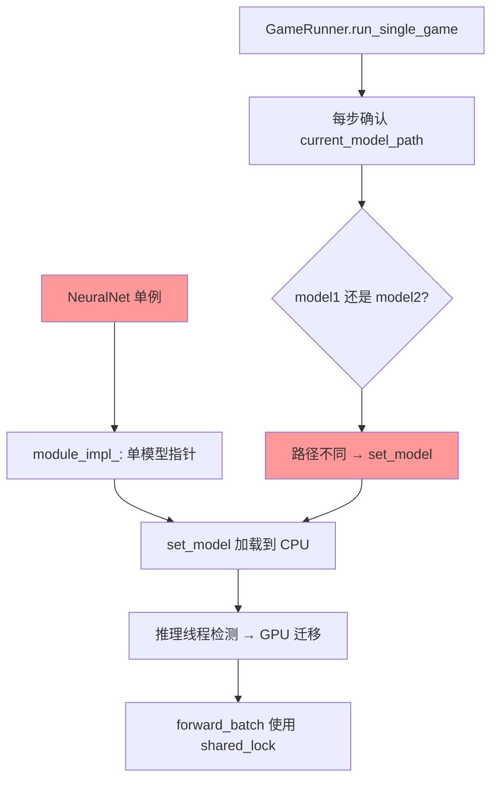

# NeuralNet 双模型支持重构

## 问题

当前 C++ `NeuralNet` 是全局单例，只能同时持有一份模型权重。当两个不同模型对弈时（如 `mcts_train_cnn_v11.py` 中 checkpoint.pt vs best.pt），**每一步棋都要切换模型**：

```
黑方落子 → set_model(checkpoint.pt) → 从磁盘加载 → GPU 迁移
白方落子 → set_model(best.pt)       → 从磁盘加载 → GPU 迁移
黑方落子 → set_model(checkpoint.pt) → 从磁盘加载 → GPU 迁移
...
```

一局棋约 30 步，50 局评估 = ~1500 次磁盘 I/O + ~1500 次 GPU 模型加载，导致：
1. **评估极慢**——大量时间浪费在反复加载同一模型上
2. **日志刷屏**——`[NeuralNet] set_model: ...` 每步都打印
3. **额外 GPU 显存抖动**——每次加载触发 GPU 内存分配/释放

## 根因分析



**核心矛盾**：`NeuralNet` 用 `void* module_impl_` 存一份模型，但 `GameRunner` 需要两方各用不同模型。两边都不是设计错误，但组合在一起产生了每步切换的问题。

自对弈模式（`mcts_sample_buffer.py`）不受影响——双方用同一个模型，`set_model` 走幂等短路，从不实际加载。

## 核心决策

| 决策项 | 选择 | 理由 |
|--------|------|------|
| 模型持有方式 | NeuralNet 内部 map<string, Module> | 按路径缓存，天然幂等 |
| 推理时模型选择 | `predict(encoded_board, model_id)` 必须显式指定模型 | 简洁明确，不需要默认模型概念 |
| GPU 显存策略 | 两个模型同时驻留 GPU | 单模型 ~34MB，两个 ~68MB，远低于训练显存，完全可接受 |
| 模型生命周期 | 预加载后一直持有，进程结束时释放 | 对战场景最多两个模型，无需复杂的 LRU/引用计数 |
| GameRunner 改动 | 构造时预加载两个模型，对局中直接按 model_id 路由 | 消除每步切换，根治性能问题 |
| 推理线程改动 | `inference_loop` 中 `forward_batch` 按 model_id 分批 | 一个 batch 可能混合两个模型的请求，需按模型分组执行 |

## 方案概要

```
改造前（每步切换）:
  GameRunner.run_single_game
    └─ for each move:
         nn.set_model(model1 或 model2)  ← 每步加载！
         nn.predict(board)

改造后（预加载，按 id 路由）:
  GameRunner 构造
    ├─ nn.preload_model("checkpoint.pt")  → module_cache_["checkpoint.pt"]
    └─ nn.preload_model("best.pt")        → module_cache_["best.pt"]
  
  GameRunner.run_single_game
    └─ for each move:
         nn.predict(board, model_id)  ← 直接路由，零开销
```

## 详细设计

### 1. NeuralNet 数据结构变更

```cpp
class NeuralNet {
private:
    // ---- 旧：单模型（删除）----
    // void* module_impl_;
    // std::string model_path_;

    // ---- 新：模型缓存 ----
    struct CachedModule {
        void* module_impl;          // torch::jit::script::Module*
        torch::Device device;       // CPU or CUDA
    };
    std::unordered_map<std::string, CachedModule> module_cache_;
    
    // 用于 predict(id) 路由：pending_requests_ 中的每条请求携带 model_id
    struct PendingRequest {
        std::vector<float> encoded_board;
        std::string model_id;       // 新增：模型标识（文件路径）
        std::promise<NeuralNetResult> promise;
    };
};
```

### 2. 公开 API（本次重构后）

```cpp
// ---- 预加载模型（幂等，已缓存则跳过）----
void preload_model(const std::string& model_path);

// ---- 按模型 ID 推理（model_id 为必选参数）----
NeuralNetResult predict(const std::vector<float>& encoded_board,
                        const std::string& model_id);
```

说明：
- `predict` 必须显式传入 `model_id`，不再提供无参版本
- `set_model` 方法直接删除，不再需要
- `model_path_` 字段删除，改为 `module_cache_` 管理所有模型

### 3. preload_model 实现

```cpp
void NeuralNet::preload_model(const std::string& model_path) {
    // 幂等：已缓存则跳过
    if (module_cache_.count(model_path)) return;

    // 加载到 CPU（不持有 model_mutex_，不影响推理线程）
    torch::jit::script::Module module = torch::jit::load(model_path);
    module.eval();
    
    CachedModule cached;
    cached.module_impl = new torch::jit::script::Module(std::move(module));
    cached.device = torch::kCPU;
    
    std::unique_lock<std::shared_mutex> lock(model_mutex_);
    module_cache_[model_path] = cached;
    
    std::cout << "[NeuralNet] preloaded: " << model_path << std::endl;
}
```

### 4. inference_loop 改造：按模型分组批处理

当前 `inference_loop` 收集一个 batch → 一次 `forward_batch`。改造后，一个收集周期内可能混合两个模型的请求，需先分组：

```cpp
void NeuralNet::inference_loop() {
    while (!stop_flag_) {
        // 阶段 1-2: 收集请求（同现状）
        std::vector<PendingRequest> batch;
        // ... 收集逻辑不变 ...

        // 阶段 3: 按 model_id 分组
        std::unordered_map<std::string, std::vector<size_t>> groups;
        for (size_t i = 0; i < batch.size(); ++i) {
            groups[batch[i].model_id].push_back(i);
        }

        // 阶段 4: 每组独立执行 forward_batch
        std::vector<NeuralNetResult> results(batch.size());
        for (auto& [model_id, indices] : groups) {
            // 确保模型已迁移到 GPU
            auto& cached = module_cache_[model_id];
            if (use_gpu_ && !cached.device.is_cuda()) {
                static_cast<torch::jit::script::Module*>(cached.module_impl)
                    ->to(torch::kCUDA);
                cached.device = torch::kCUDA;
            }
            
            // 收集该组的输入数据
            std::vector<std::vector<float>> group_data;
            for (size_t idx : indices) {
                group_data.push_back(std::move(batch[idx].encoded_board));
            }
            
            // 执行推理
            auto group_results = forward_batch(group_data, model_id);
            for (size_t j = 0; j < indices.size(); ++j) {
                results[indices[j]] = std::move(group_results[j]);
            }
        }

        // 阶段 5: 返回结果（同现状）
        for (size_t i = 0; i < batch.size(); ++i) {
            batch[i].promise.set_value(std::move(results[i]));
        }
    }
}
```

**关键设计决策**：不尝试在一个 batch 中混合两个模型做推理（虽然技术上可以拼接成更大的 batch，但两个模型结构相同、权重不同，无法合并为单次 CUDA kernel 调用）。分组后各自独立 `forward_batch`，攒批效率的损失很小——实际场景中同一时刻几乎不会有来自两个模型的并发请求（因为对弈是串行的：只有当前方的 MCTS 在搜索，对方在等待）。

### 5. forward_batch 签名变更

```cpp
// 旧：
std::vector<NeuralNetResult> forward_batch(
    const std::vector<std::vector<float>>& batch);

// 新：增加 model_id 参数以指定使用哪个缓存的模型
std::vector<NeuralNetResult> forward_batch(
    const std::vector<std::vector<float>>& batch,
    const std::string& model_id);
```

内部通过 `module_cache_[model_id].module_impl` 获取 `torch::jit::Module*`，其余逻辑不变。旧的无参版本删除。

### 6. GameRunner 适配

对战模式构造时预加载两个模型：

```cpp
GameRunner::GameRunner(const std::string& model1_path,
                       const std::string& model2_path,
                       int num_games,
                       const GameConfig& config,
                       int num_workers) {
    // ... 现有逻辑 ...
    
    NeuralNet::initialize(model1_path_, config_.use_gpu);
    
    // 预加载第二个模型（新增）
    if (model1_path_ != model2_path_) {
        NeuralNet::instance().preload_model(model2_path_);
    }
}
```

`run_single_game` 中删除 `set_model` 调用和 `last_model_path` 追踪，改为在 `MctsSearcher` 内部直接按 `model_path_` 路由：

```cpp
void GameRunner::run_single_game(int game_index) {
    // ... 确定执方 ...
    
    // 不再需要 set_model 和 last_model_path 追踪
    MctsSearcher searcher1(model1_path_, pool, nn, ...);
    MctsSearcher searcher2(model2_path_, pool, nn, ...);
    
    // 对局主循环:
    while (move_count < 225) {
        MctsSearcher* current = (current_player == model1_color) 
                                ? &searcher1 : &searcher2;
        // searcher 内部通过 model_path_ 作为 model_id 调用 predict
        MctsResult result = current->search(state);
        // ...
    }
}
```

### 7. MctsSearcher 适配

`MctsSearcher` 的 `model_path_` 字段天然适合作为 `model_id`。在 `run_one_simulation` 中调用 `nn.predict(encoded_board, model_path_)` 即可。

需新增 `predict` 重载调用点：

```cpp
// MctsSearcher 内部
NeuralNetResult result = nn_->predict(encoded_board, model_path_);
```

## 影响范围

### 修改文件

| 文件 | 改动量 | 说明 |
|------|--------|------|
| `cpp/src/neural_net.h` | ~25 行 | 新增 `CachedModule` 结构体、`preload_model`/`predict(id)` 声明、`module_cache_` 字段；删除 `module_impl_`、`model_path_`、`set_model`、旧 `predict()` |
| `cpp/src/neural_net.cpp` | ~90 行 | 实现 `preload_model`、改造 `inference_loop` 分组逻辑、改造 `forward_batch`、新增 `predict(id)`；删除 `set_model`、旧 `predict()` |
| `cpp/src/game_runner.cpp` | ~10 行 | 构造时 `preload_model(model2)`，`run_single_game` 删除 `set_model` 调用和 `last_model_path` 追踪 |
| `cpp/src/mcts_searcher.cpp` | ~5 行 | `nn_->predict(board)` → `nn_->predict(board, model_path_)` |
| `cpp/src/bindings.cpp` | 需更新 | pybind11 绑定：删除 `set_model` 暴露，`predict` 签名改为双参数 |

### 不受影响的模块

- `MctsThreadPool`——不涉及模型管理
- `MctsSearcher` 旧式构造器（自建 `NeuralNet` 实例）——独立实例只持有一个模型，内部 `predict` 调用需更新签名
- 自对弈模式（`mcts_sample_buffer.py`）——双方同模型，`preload_model` 只加载一次即可
- 所有 Python 脚本——C++ 内部重构，对上层透明（但 pybind11 绑定需更新签名）

### 风险评估

| 风险 | 概率 | 缓解措施 |
|------|------|----------|
| 多模型 GPU 显存翻倍 | 低 | 双模型 ~68MB + 训练模型 ~200MB = ~270MB，4GB 显卡完全够 |
| 按模型分组导致攒批效率下降 | 极低 | 对弈场景下同一时刻只有一个模型有推理请求 |
| `module_cache_` 无限增长 | 低 | 对战场景最多两个模型，自对弈只有一个，无增长风险 |

## 测试计划

### C++ 单元测试

| 测试 | 内容 |
|------|------|
| preload_idempotent | 同一路径 preload 两次，只加载一次 |
| predict_with_model_id | 两个不同模型分别 predict，结果不同 |
| cache_two_models | 缓存两个模型，验证 module_cache_ size=2 |
| forward_batch_different_models | 同一 batch 混合两个模型的请求，各自正确 |

### Python 集成测试

| 测试 | 内容 |
|------|------|
| evaluate_win_rate | CheckpointEvaluator 评估流程，验证无 set_model 刷屏 |
| self_play_unaffected | mcts_sample_buffer.py 工作正常 |
| mcts_battle_cpp | mcts_battle_cpp.py 工作正常 |

### 构建验证

```powershell
build_cpp.bat
ctest --test-dir cpp/build --output-on-failure
```

## 预期效果

| 指标 | 改造前 | 改造后 |
|------|--------|--------|
| 每局模型加载次数 | ~30 次（每步） | 0 次（预加载） |
| 50 局评估耗时（估计） | ~60s | ~15s（消除 I/O） |
| `[NeuralNet] set_model` 日志行数 | ~1500 行 | 2 行（preloaded） |
| GPU 显存峰值 | ~100 MB | ~170 MB（+68MB 双模型） |

## 实现步骤

1. **NeuralNet 核心改造**：`CachedModule` + `preload_model` + `predict(id)` + 分组 `inference_loop`，删除 `set_model`/`module_impl_`/`model_path_`/旧 `predict()`
2. **bindings.cpp 更新**：pybind11 绑定适配新 API 签名
3. **GameRunner 适配**：构造时预加载 + 对局中去掉 `set_model` 和 `last_model_path`
4. **MctsSearcher 适配**：`predict` 调用加 `model_path_`
5. **C++ 单测**：TDD 先写测试，再写实现
6. **Python 集成测试**：验证评估流程和自对弈不受影响
7. **构建 + 全量测试**
