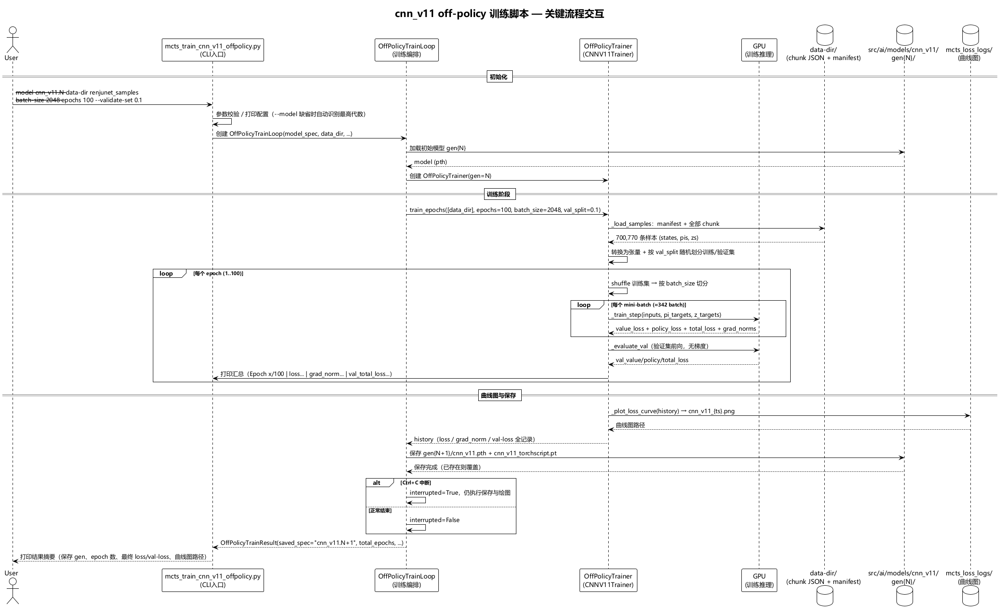
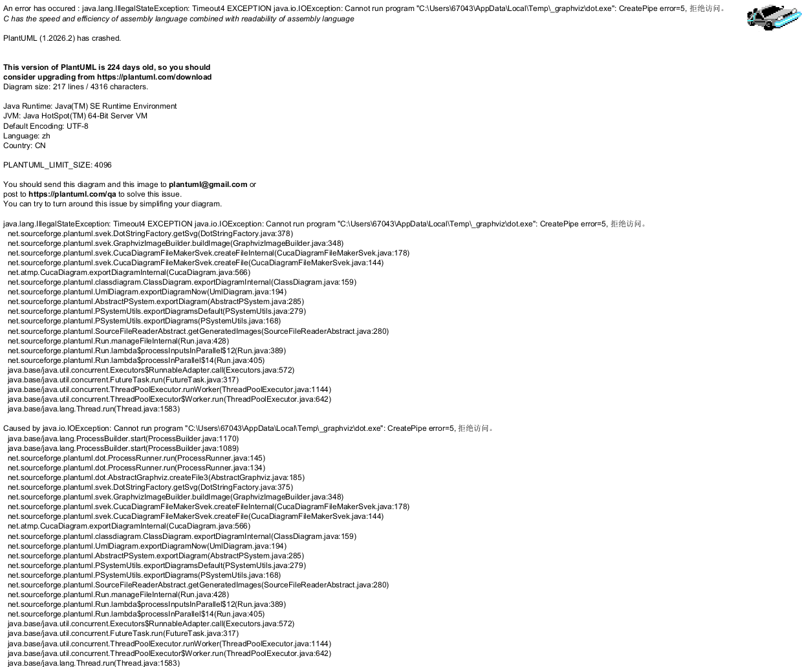

# cnn_v11 off-policy 监督训练脚本

## 问题

现有 cnn_v11 训练脚本（`mcts_train_cnn_v11.py`）采用**增量式**训练：从持续写入的动态缓冲区随机抽取 mini-batch，无 epoch 概念，依赖 C++ MCTS 对战评估晋升。该范式无法利用**静态样本集**（如 renjunet_samples 人类棋谱样本，700,770 条）做多轮全量学习。需要一个 off-policy 监督训练脚本：对指定目录下的全部样本做多个 epoch 的 mini-batch 训练，打印并记录训练指标，结束后生成曲线图。

## 核心决策

| 决策项 | 选择 | 理由 |
|--------|------|------|
| 训练范式 | 静态数据集多 epoch 全量遍历 + mini-batch | 意图明确：对指定目录所有样本做多 epoch 训练 |
| 训练执行 | 复用 `DualHeadTrainer.train_epochs` | 已实现 epoch 循环、每 epoch shuffle、val_split 划分、batch 切分、自动绘图，避免重复开发 |
| 数据加载 | 新增 `OffPolicyTrainer` 子类覆盖 `_load_samples`，支持 chunk JSON 目录（manifest.json + chunk_*.json），兼容 sample.json | renjunet_samples 与 sample_buffer 同格式；`_load_samples` 为静态方法，子类覆盖后 `train_epochs` 经多态调用，零侵入基类数据加载逻辑 |
| 模型加载 | `--model` 可选，默认自动识别 cnn_v11 最高代数 | 用户确认：从最高代数加载继续训练 |
| 模型保存 | 训练结束保存为 `gen{N+1}/`（`cnn_v11.pth` + `cnn_v11_torchscript.pt`），TorchScript 用 `torch.jit.script` 导出 | 用户确认：与现有多代体系一致，可被后续对战/评估使用；与 `CnnV11TrainLoop` 晋升保存产物同构 |
| 进度打印 | 仅每 epoch 打印一次汇总：loss、梯度范数、val-loss | 用户确认：100 epoch 共 100 行日志，含 epoch 序号即进度信息 |
| 曲线图 | epoch 级双 Y 轴曲线（左轴 loss/val-loss，右轴梯度范数），复用 `_plot_loss_curve` 保存至 `mcts_loss_logs/` | 用户确认：epoch 级曲线，100 个点清晰可读 |
| 基类改动 | ① `train_epochs` E6 打印行追加 `grad_norm` 字段；② `train_epochs` 加载样本后增加空样本防御（`if not all_states: return []`） | 意图要求打印梯度；空样本防御使 TC-OPT-10（空目录经 `train_epochs` 调用不抛异常）成立（用户确认，方案 A：基类防御，避免 `_convert_inputs([])` 崩溃）；两处改动均向后兼容，影响面可控 |
| 中断处理 | Ctrl+C 走 `train_epochs` 优雅路径（生成图表）；中断后仍保存 `gen{N+1}`，结果标记 `interrupted=True` | 已训练的 epoch 成果不丢失；不注册 `os._exit` 级 SIGINT handler，避免跳过图表生成 |
| 编排器 | 新增 `OffPolicyTrainLoop`（参照 `CnnV11TrainLoop` 模式） | 可测试、可复用，CLI 保持轻薄 |

## 方案概要

```
python -m ai.scripts.mcts_train_cnn_v11_offpolicy [--model cnn_v11.N] [--data-dir renjunet_samples]
    [--batch-size 2048] [--epochs 100] [--validate-set 0.1] [--lr 0.001]
    [--weight-decay 1e-4] [--device cuda]

OffPolicyTrainLoop
  ├── OffPolicyTrainer (继承 CNNV11Trainer) — 覆盖 _load_samples 加载 chunk 目录
  │     └── 调用基类 train_epochs → epoch 循环 + mini-batch + val_split + 每 epoch 打印 + 自动绘图
  └── CNNV11Model — 保存 gen{N+1}

训练流程:
  加载模型（--model 或最高代数）
  → 加载 data_dir 全部样本（chunk JSON / sample.json）
  → 按 validate-set 比例随机划分训练集/验证集
  → 每 epoch: shuffle → 按 batch-size 切分 → 逐 batch _train_step → 评估 val-loss → 打印汇总
  → 结束后自动生成曲线图（mcts_loss_logs/cnn_v11_{ts}.png）
  → 保存 gen{N+1}/cnn_v11.pth + cnn_v11_torchscript.pt
```

## 模块清单

### 新增文件

| 文件 | 类 | 职责 |
|------|-----|------|
| `src/ai/off_policy_trainer.py` | `OffPolicyTrainer` | 覆盖 `_load_samples`：加载 chunk JSON 目录全部样本（兼容 sample.json），格式校验与损坏容错 |
| `src/ai/off_policy_train_loop.py` | `OffPolicyTrainLoop` | 训练编排：加载模型 → 调 `train_epochs` → 保存 `gen{N+1}`，返回结果 |
| `src/ai/scripts/mcts_train_cnn_v11_offpolicy.py` | — | CLI 入口（参数解析/校验/配置打印/结果输出） |
| `tests/unit/test_off_policy_trainer.py` | — | `OffPolicyTrainer` 测试 |
| `tests/unit/test_off_policy_train_loop.py` | — | `OffPolicyTrainLoop` 测试 |

### 模块变更

| 文件 | 变更 | 影响 |
|------|------|------|
| `src/ai/dual_head_trainer.py` | ① `train_epochs` E6 打印行追加 `grad_norm: {avg_grad_norm:.4f}` 字段；② `train_epochs` 样本加载后增加空样本防御（`if not all_states: return []`） | 仅日志多一字段 + 空目录优雅返回空 history，所有现有调用方行为不变 |

### 不改动

- `CNNV11Trainer` / `CNNV11Model` / `CNNV11Network` — 直接复用
- `DualHeadTrainer._train_step` / `_convert_inputs` / `_plot_loss_curve` / `save_model` — 直接复用
- `SampleBufferReader` — 不复用（其不放回随机抽样语义不适合 epoch 全量遍历，加载逻辑由 `OffPolicyTrainer` 自实现）
- `LossLogger` — 不引入（epoch 级曲线由 `_plot_loss_curve` 产出，无需 step 级密集日志）

## 关键流程与类关系

- 关键流程交互图（详见 [main_flow.puml](main_flow.puml)）：



- 类图与依赖关系图（详见 [class_diagram.puml](class_diagram.puml)）：



## 接口设计

各模块公开接口（含 CLI 参数表）见 [interface.md](interface.md)

## 测试用例集

完整测试用例集见 [test_cases.md](test_cases.md)

## 数据规模提示

renjunet_samples 全量 700,770 样本（约 1.2GB JSON），加载为原始列表约占 2~3GB 内存，转换为训练张量另需约 2.5GB（inputs (N,3,15,15) float32 ≈ 1.9GB + pi (N,225) ≈ 0.63GB）。100 epoch × 342 batch/epoch ≈ 34,200 次参数更新，单 epoch 打印一行，日志量约 100 行。

## 训练产物

训练结束在 `src/ai/models/cnn_v11/gen{N+1}/` 下生成：

| 文件 | 说明 |
|------|------|
| `cnn_v11.pth` | PyTorch 权重文件 |
| `cnn_v11_torchscript.pt` | TorchScript 模型（供 C++ MCTS 使用） |

曲线图产物：`mcts_loss_logs/cnn_v11_{YYYYMMDD_HHMMSS}.png`（双 Y 轴：左轴 total/value/policy loss + val_total_loss，右轴 grad_norm）。

gen 编号规则：初始模型为 `cnn_v11.N` 时保存为 `gen{N+1}`；`gen{N+1}` 已存在时覆盖并打印提示。
