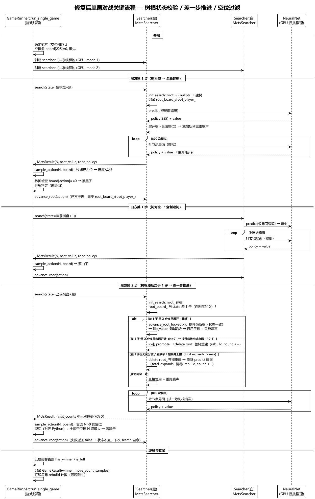

# C++ MCTS 搜索树状态校验与落子合法性修复设计

**设计编号**: 59
**日期**: 2026-09-02
**问题依据**: [intention/report/mcts_battle_cpp_vs_gui_discrepancy_20260902.md](../../intention/report/mcts_battle_cpp_vs_gui_discrepancy_20260902.md)
**适用代码**: `cpp/src/`（mcts_searcher、game_runner、mcts_node）

---

## 问题回顾

CLI 双模型对战（`mcts_battle_cpp.py`）cnn_v11.1 vs cnn_v11.2 结果为五五开（48%/52%），但 GUI（Python MCTS）实测 v11.2 远强（随机权重的 gen1 每局 9~10 手被速胜）。调查结论：**CLI 结果不可信，是 C++ 引擎两处缺陷叠加导致双方棋力崩塌的假象**：

1. **缺陷 A（根因）**：`MctsSearcher::init_search` 子树复用分支只检查 `root_ != nullptr`，**不校验树根局面与传入 state 是否一致**。GameRunner 交替对弈中，每个 searcher 只推进自己的落子，轮到己方时树根滞后对手 1 手且视角停留在"对手该走"，搜索在错位树上进行。
2. **缺陷 B（放大）**：`GameRunner::sample_action` 只按 `visit_counts > 0` 选动作，**不检查真实棋盘空位**；错位树的高访问边（对手刚落子位置）会被重复落子，覆盖对方棋子 → 非法棋局、胜负失真。

Python 对照实现（`src/ai/mcts/searcher.py` root_hash 校验、`policy_value.py` 空位过滤）语义正确，故 GUI 无此问题。C++ 端所有经 `GameRunner` 的路径（CLI 对战、自对弈样本采集、训练 checkpoint 评估）均受影响。

---

## 设计目标

1. **搜索正确性**：搜索树根必须始终与实际棋盘状态一致（对齐 Python `root_hash` 语义）；不一致时重建。
2. **落子合法性**：实际落子位置必须是真实棋盘空位（对齐 Python `_select_greedy_n` 过滤语义）。
3. **保持子树复用收益**：能复用时尽量复用（如对手落子恰在己方树已探索分支中），避免"每次搜索都整树重建"的性能退化。
4. **兼容性**：公开 API（pybind11 暴露的 `search`/`advance_root`、GameRunner 构造与运行接口）签名不变，所有现有调用方（CLI 对战、样本采集、checkpoint 评估、CppMctsAdapter）行为自动修复，无需 Python 侧改动。

---

## 核心决策

| 决策项 | 选择 | 理由 |
|--------|------|------|
| 树根状态记录位置 | `MctsSearcher` 成员：`root_board_`(225) + `root_player_`，与 `root_` 同步维护 | 不侵入 `MctsNode` 节点结构；根状态由 searcher 生命周期管理，新建/推进/销毁各路径单一维护点 |
| 不一致处理策略 | 三分支：一致→复用；**差 1 步且子边存在且已展开（非叶）→内部推进后复用**；其余（含差 1 步但目标为未访问叶）→整树销毁重建 | 差 1 步推进使 GameRunner 交替场景能最大化复用；promote 目标限"已展开节点"：叶节点（N=0、无子边）被提升为根后 800 次模拟将全部空转（select_child 对空 children 返回 -1）→ visit_counts 全 0 → 弃局（P0-1 修订）；弱方（随机权重）树浅层 N>0 边占比极低，其对手着法几乎必然命中未访问叶 → 走重建分支（与 Python 每步重建语义等价，正确性优先） |
| 主循环 `advance_root(action)` 调用 | 保留 | 己方落子后立即推进，使下次轮到时仅差对手 1 步（进入"差 1 步推进"分支）；若移除则差 2 步必重建，损失全部复用 |
| `sample_action` 过滤 | 增加 `board` 参数，候选 = `visit_counts>0 && board[i]==0` | 树正确后 visit_counts>0 集合应恰为真实空位，过滤为纯防御；但若推进失败重建路径有遗漏，此过滤杜绝覆盖落子 |
| root_policy 语义 | 每个展开节点保存自身局面的原始策略（噪声前）；通过新增 `MctsNode::expand_with_policy` 在 expand 锁内原子完成（展开 + 存储） | 推进后的新根是原子节点，原本未持有 225 维策略；存储必须并入 expand 的 `expand_lock_` 临界区内——并发 worker 可能同时判定同一 child 为叶双双进入展开流程，锁外 `set_root_policy` 双写 vector 属数据竞争（P1-1 修订）。内存增量约 900B/展开节点，为**单次搜索瞬时上界**（800 sims ≈ 720KB）；跨步累积另设上限（见修复点 5） |
| 修复范围 | 仅 C++（mcts_searcher.h/.cpp、game_runner.h/.cpp）；Python 不改 | Python 已正确（root_hash + 空位过滤），GUI fallback 路径不受影响 |
| root_value 视角口径 | 节点被提升为根时翻转 q（`MctsNode::flip_value`，父视角边价值 → 自身视角节点价值） | backup 数值链：非根节点 q_sa_ 存父视角（边价值）、根节点 q_sa_ 存自身视角（根特判取反）；推进把非根节点提升为根后历史 q 与新累积口径混同 → root_value 漂移。翻转后口径一致（P1-2；Python 推进后树从不复用故天然无此问题，C++ 修复后语义对齐干净树） |
| 树内存限幅 | `MctsSearcher` 维护总展开计数，超限整树重建（上限经 mcts_config 新键 `max_tree_expands` 配置，默认 20000，0=不限） | GameRunner 中树沿真实走法跨步保留、展开节点单调累积，225 步对局单树可达数万节点（约 10~100MB/树）；多 worker × 2 树可达 GB 级边缘。限幅正确性无损（重建语义与 Python 一致），仅损复用（P1-3） |
| 数据补偿 | 缺陷期间 **C++ 自对弈采集进 sample_buffer 的样本**视为可疑，重建缓冲区后重训作为后续动作（另立意图）；renjunet_samples 为 RIF 棋谱转换产物、不经 GameRunner，**不受影响** | 自对弈样本采集同走 GameRunner，覆盖落子与错位树产生的 pi 会污染训练数据；两类样本来源需区分表述（P3-2） |

---

## 修复规格

### 修复点 1：`MctsSearcher` 树根状态跟踪与一致性校验（mcts_searcher.h / mcts_searcher.cpp）

**新增私有状态**：

| 成员 | 类型 | 说明 |
|------|------|------|
| `root_board_` | `std::vector<int>` | 树根局面棋盘（225 维），仅 `root_ != nullptr` 时有意义 |
| `root_player_` | `int` | 树根局面的当前落子方（1=黑/2=白） |

**维护规则（`root_mutex_` 保护下）**：

- 全新建树（`init_search` 新树分支、终局分支）：置为传入 state 的 board/player。
- `advance_root(action)` 成功：置为推进后的局面（落子 action、玩家翻转），并 `flip_value()` 翻转新根 q（见修复点 4）。
- `advance_root(action)` 失败（子节点不存在或为叶）：状态不变（下次 search 按不一致路径自愈）。
- 树销毁：清空标记（可置 `root_player_ = -1` 表示无树，避免误判）。

**实现提示（P3-4）**：`advance_root` 与 `promote` 共用提升逻辑，提取私有 `advance_root_locked(action)`（持锁上下文：get_child → detach → delete 旧根 → 换根 → 更新根状态 → flip_value），公开 `advance_root` 与 `init_search` 内部均调用之，避免两份 detach/delete/换根逻辑漂移。

**`init_search(state)` 行为规格（伪码）**：

```
init_search(state):
    board = state[0:225]; player = state[225]
    lock(root_mutex_)
    if root_ != nullptr:
        if total_expands_ > max_tree_expands_:          # 修复点 5：内存限幅，超限重建
            delete root_; root_ = nullptr; total_expands_ = 0; ++rebuild_count_
        elif root_board_ == board and root_player_ == player:
            reuse_tree(board, player)                   # ① 一致 → 现状复用逻辑（快照 N + 噪声）
            return
        else:
            x = one_step_diff(root_board_, root_player_, board, player)
            child = (x >= 0) ? root_->get_child(x) : nullptr
            if child != nullptr and not child->is_leaf():
                advance_root_locked(x)                  # ② 差 1 步且分支已展开（非叶）→ 内部推进
                reuse_tree(board, player)
                return
            # ③ 其余（差多子 / 目标为未展开叶 / 无此分支）→ 整树销毁重建
            delete root_; root_ = nullptr; total_expands_ = 0; ++rebuild_count_
    # 全新建树（现状逻辑 + 设置 root_board_/root_player_ + total_expands_ = 0）
    ...

reuse_tree(board, player):
    root_edge_n_snapshot_ = root_->get_visit_counts()
    root_policy_ = root_->get_root_policy()      # 新根为推进节点时读取其自身策略（修复点 3 保证已存）
    legal = [i | board[i] == 0]
    add_dirichlet_noise(root_, legal)

one_step_diff(prev_board, prev_player, board, player):
    # 恰差 1 子且符合"交替一子"语义，返回该位置 x；否则返回 -1
    if player != 3 - prev_player: return -1
    x = -1
    for i in 0..224:
        if board[i] != prev_board[i]:
            if prev_board[i] != 0 or board[i] != prev_player: return -1   # 必须是 prev_player 刚落一子
            if x >= 0: return -1                                          # 多于 1 处差异
            x = i
    return x
```

**P0-1 关键约束（必须实现）**：promote（分支 ②）目标必须是**已展开节点**（`!child->is_leaf()`，等价于该边曾被模拟访问、N≥1）。若目标为未展开叶节点（expand 创建了边但从未被选中），提升后新根无子边：`select_child` 对空 children 返回 -1（mcts_node.cpp L22）→ 800 次模拟全部空转 → `visit_counts` 全 0 → 弃局。叶目标一律走分支 ③ 整树重建。

### 修复点 2：`GameRunner::sample_action` 空位过滤 + Python 对齐兜底（game_runner.h / game_runner.cpp）

- `sample_action` 签名增加 `const std::vector<int>& board` 参数；候选收集条件由 `visit_counts[i] > 0` 改为 `visit_counts[i] > 0 && board[i] == 0`。
- **兜底链与 Python 对齐（P2-1）**：候选集为空（全部空位 N=0，搜索空转）时，退化为"全部空位按 N 取最大者（含 N=0）"——对齐 Python `_select_greedy_n`（空位全集、best_n 初值 -1，N=0 的空位同样入选，全 0 时兜底返回 0），保证"引擎异常不废整局"；仅当棋盘无空位（满盘）才返回 -1。
- `run_single_game` 主循环落子处防御（理论不可达，兜底防非法棋局）：

```
action = sample_action(mcts_result.visit_counts, move_count, board, config_)
if action < 0:  break                      # 仅满盘时才可能（不会发生）
if board[action] != 0:                     # 防御：仍选中已占位 → 从空位取 N 最大者
    print("[GameRunner] 警告: action 覆盖已有棋子, 回退到空位中 N 最大者")
    action = argmax(mcts_result.visit_counts[i] for i where board[i]==0)
board[action] = current_player
```

### 修复点 3：展开节点保存自身原始策略——并入 expand 锁内（mcts_node.h / mcts_searcher.cpp）

- `MctsNode` 新增公开方法 `bool expand_with_policy(action_priors, legal_actions, full_policy)`：在 `expand_lock_` 临界区内原子完成"展开 + 存储自身局面原始策略（噪声前 225 维）"；幂等语义与 `expand` 一致（已展开返回 false），返回是否由本次调用真正展开。
- `run_one_simulation` 阶段 3（Expansion）改调 `expand_with_policy`：展开成功（返回 true）时 `total_expands_` 递增并 `backup`。
- **并发正确性（P1-1）**：不得在 expand 返回后锁外调用 `set_root_policy`——两个 worker 可同时判定同一 child 为叶（`is_leaf()` 检查无锁）双双进入展开流程，锁外双写 `std::vector` 属数据竞争（UB）；存储必须与展开同一临界区原子完成，由幂等返回决定唯一写入者。
- 效果：任意节点被提升为新根后 `get_root_policy()` 可返回正确策略；`reuse_tree` 中 `root_policy_` 随之刷新，狄利克雷噪声混合与 `get_result().root_policy` 均与真实树根局面一致。
- 既有 `expand` 保留（`init_search` 建根 + 单测使用，无竞争场景），不改签名。

### 修复点 4：节点提升为根时翻转价值视角（mcts_node.h / mcts_searcher.cpp）

- `MctsNode` 新增公开方法 `void flip_value()`：`q_sa_ = -q_sa_`（n_visited_ 不变）。
- 背景（P1-2，backup 数值链见 mcts_node.cpp L69-97）：非根节点 q_sa_ 存**父视角**（边价值），根节点 q_sa_ 存**自身视角**（根特判取反）；`advance_root_locked` 把非根节点提升为根后，其历史 q 累积仍为父视角（= 新根对手视角，符号差一），与后续按根特判的新累积混入同一运行均值 → root_value 向 0 漂移失真。
- 规则：**每次节点被提升为新根（advance_root 与 promote 共用路径）后立即 `flip_value()`**。调用时机无并发：推进只发生在 search 完成（wait_all 返回、worker 全部结束）之后或 init_search 的模拟开始之前。
- 影响面：`visit_counts`（落子与 pi 的唯一依据）不受影响；修复使 root_value 在推进/复用场景与 Python 干净树语义对齐（Python 因 root_hash 机制推进后树从不复用，天然无此问题）。

### 修复点 5：树规模限幅（防跨步内存累积，mcts_searcher.h / mcts_config 链路）

- `MctsSearcher` 新增私有计数 `std::atomic<int> total_expands_`（每次 `expand_with_policy` 真正展开 +1；整树重建/新建时清零）。
- `init_search` 复用相关分支（①/②）前检查 `total_expands_ > max_tree_expands_` → 超限走整树重建（清零计数，rebuild_count_++）。
- 上限配置链路（P1-3）：`MctsConfig` 新增字段 `int max_tree_expands = 20000;`；bindings.cpp `load_mcts_config` 增加 `get_int("max_tree_expands", 20000)` 解析行；`cpp/python/mcts_config.json` 增加同名键（缺省时 fallback 默认值）。0 = 不限。
- 量级：节点基础开销 + 225 float 策略 ≈ 1.2KB/展开节点 → 20000 节点 ≈ 24MB/树（10 worker × 2 树 ≈ 480MB 上界，可接受）。
- 正确性：限幅仅触发重建（与 Python 每步重建语义等价），无损落子正确性，仅损子树复用。

### 不做的事

- 不改 Python 侧（searcher.py / policy_value.py / builder.py / GUI）：Python 语义已正确。
- 不改 pybind11 绑定接口（`cpp/src/bindings.cpp` 暴露的类/方法签名不变）；仅在 `load_mcts_config` 内新增 `max_tree_expands` 一行字段解析（见修复点 5）。
- 不把噪声、温度等参数硬编码入代码（维持 `GameConfig` 现有通道）。
- 不改变 GameRunner 主循环的 `advance_root(action)` 调用（保留以最大化复用，见决策表）。

---

## 关键流程交互

修复后单局对战关键流程（状态判定/推进/过滤）交互图见 [main_flow.puml](main_flow.puml)：



---

## 接口设计

公开接口变化与行为说明见 [interface.md](interface.md)

## 测试用例集

完整测试用例集（C++ 单元/集成 + Python 端到端验证）见 [test_cases.md](test_cases.md)

---

## 影响与后续

### 直接受益方（行为自动修复，需回归验证）

| 调用方 | 说明 |
|--------|------|
| `mcts_battle_cpp.py`（CLI 对战） | 修复后 v11.1 vs v11.2 应呈现真实差距 |
| `checkpoint_evaluator`（`mcts_train_cnn_v11.py` 评估） | 晋升评估搜索恢复正确 |
| `mcts_sample_buffer.py` 自对弈样本采集 | 样本 state/pi 恢复正确 |
| `CppMctsAdapter`（GUI 若开启 C++ 引擎） | search/advance_root 用法兼容且自愈 |

### 已存数据补偿建议（后续单独处理）

- **受影响**：缺陷期间 C++ 自对弈（`mcts_sample_buffer.py`）采集进 sample_buffer 的样本——覆盖落子与错位树产生的 pi 会污染训练数据，建议修复验证通过后重建样本缓冲区并重训新一代模型。
- **不受影响**：renjunet_samples 为 RIF 棋谱转换产物（不经 GameRunner），无需重转（P3-2）。
- 修复前的 CLI 对战/评估结论不可信，不应作为模型晋升依据。

### 可观测性（推荐随修复一并实施）

- `MctsSearcher` 增加整树重建计数（`std::atomic<int> rebuild_count_` + 公开只读 `get_rebuild_count()`），GameRunner 每局结束打印一次（局号、双方重建次数）。
- 解读预期（P2-3）：同强度对局（自对弈/评估）中双方重建次数应显著小于步数（差 1 步推进分支为主）；**强弱悬殊对局（如 v11.1 随机权重 vs v11.2）中弱方几乎每步重建**（其树浅层 N>0 边占比极低、对手着法命中未展开叶 → 走重建分支），重建次数接近步数属正常，不得误判为回归。
