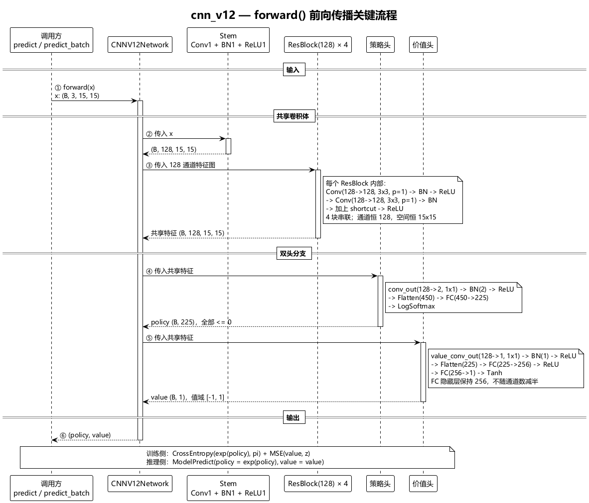
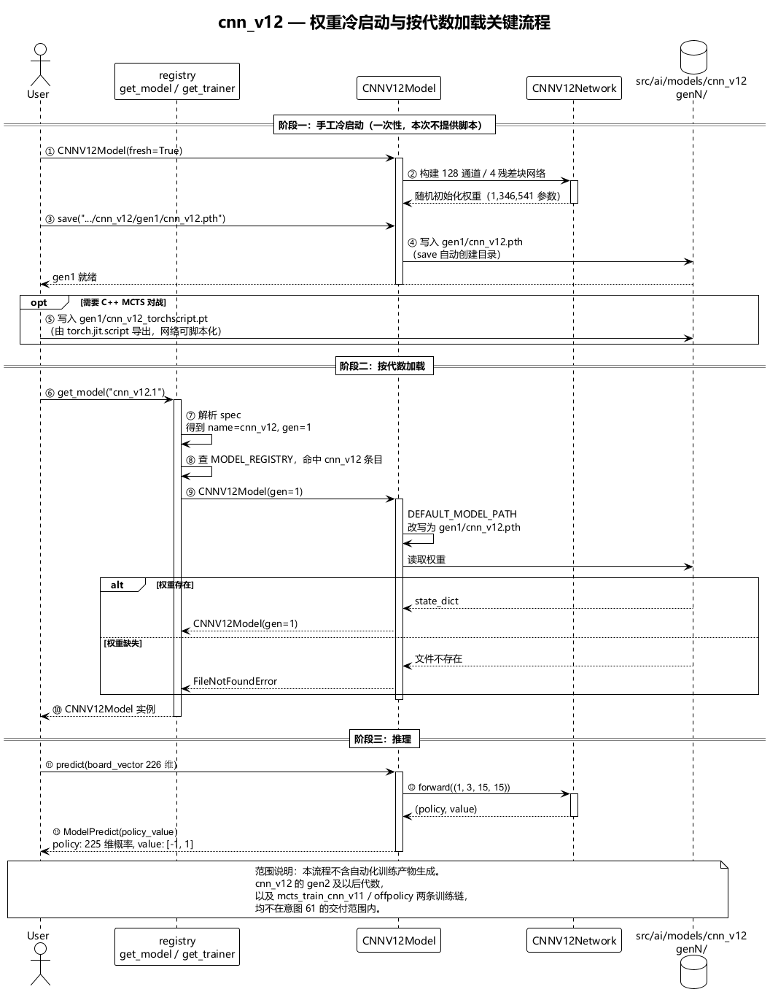
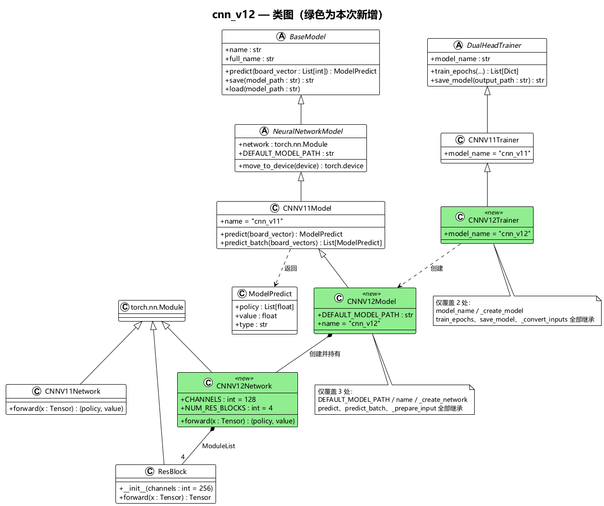
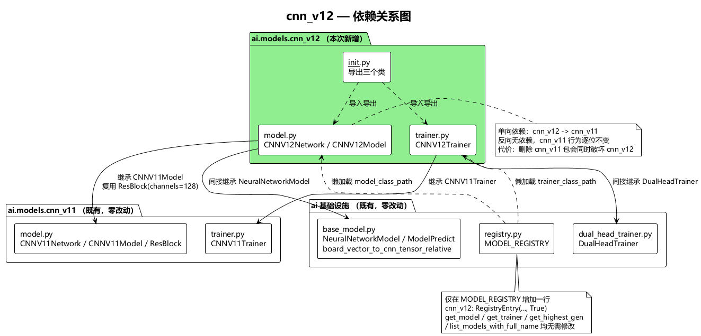

# CNN v12 轻量双头模型设计

> 意图 61 | 新增模型：cnn_v12 | 基座模型：cnn_v11

---

## 1. 概述

在 cnn_v11 基础上做等比例瘦身，得到更小更快的双头模型 cnn_v12：**残差塔由 7 块降为 4 块，卷积通道由 256 降为 128**。策略头与价值头的结构与 cnn_v11 **完全一致**，仅输入通道数随之变化。

设计目标：保留 cnn_v11 的全部工程属性（相对视角编码、双头输出、TorchScript 可导出、多代权重体系），把单样本前向计算量降到约 1/7，用于提升 MCTS 自对弈与对战吞吐。

### 1.1 核心变动（对照 cnn_v11）

| 组件 | cnn_v11 | cnn_v12 |
|------|---------|---------|
| 残差块数 | 7 | **4** |
| 卷积通道数 | 256 | **128** |
| 初始卷积 | Conv2d(3→256, 3×3, p=1) | Conv2d(3→**128**, 3×3, p=1) |
| 塔内卷积层 | 7 × 2 = 14 | **4 × 2 = 8** |
| 进入双头前的卷积层总数 | 1 + 14 = 15 | **1 + 8 = 9** |
| 共享特征张量 | (B, 256, 15, 15) | **(B, 128, 15, 15)** |
| 策略头 | conv(256→2, 1×1) → BN → ReLU → Flatten(450) → FC(450→225) → LogSoftmax | conv(**128**→2, 1×1) → BN → ReLU → Flatten(450) → FC(450→225) → LogSoftmax |
| 价值头 | conv(256→1, 1×1) → BN → ReLU → Flatten(225) → FC(225→256) → ReLU → FC(256→1) → Tanh | conv(**128**→1, 1×1) → BN → ReLU → Flatten(225) → FC(225→256) → ReLU → FC(256→1) → Tanh |
| 参数量 | 8,436,333（~843 万） | **1,346,541（~135 万）** |
| 相对参数规模 | 1.000 | **0.160**（1/6.3） |
| 单样本前向 MAC | ~1.86 G | **~0.27 G**（1/7.0） |
| 单样本激活张量 | (256, 15, 15) / 层 | **(128, 15, 15) / 层**（减半） |

> 参数量 8,436,333 与 1,346,541 均为实测值（`sum(p.numel() for p in network.parameters())`），非估算。

### 1.2 与现有体系的关系

- **完全复用，零改动**：`NeuralNetworkModel` 基类、`DualHeadTrainer` 训练基类、相对视角编码 `board_vector_to_cnn_tensor_relative`、cnn_v11 已按 `channels` 参数化的残差块 `ResBlock`。
- **完全复用，零改动**：registry 懒加载与多代体系、`create_engine` 的类型路由、C++ 侧 TorchScript 加载（架构由 TorchScript 自包含）。
- **新增**：`src/ai/models/cnn_v12/` 包（3 个文件）+ `registry.py` 一行注册。

---

## 2. 关键设计决策

| 决策项 | 选择 | 理由 |
|--------|------|------|
| 残差塔深度 | 4 个残差块 | 用户确认。塔高度单位在本仓库既有多代模型中恒为「残差块」（cnn_v9 的「目前是 2」即 2 块），故 7→4 指块数 |
| 128 通道作用范围 | 仅共享卷积体 | 用户确认。意图只写「channels」；策略头 `Flatten` 维度 450 = 2×15×15、价值头 `Flatten` 维度 225 = 1×15×15，均与卷积通道数无关；价值头 FC 隐藏层 256 属 FC 宽度而非卷积通道，保持不变 |
| 残差块实现 | 复用 cnn_v11 的 `ResBlock` | 该类已参数化为 `ResBlock(channels: int = 256)`，实例化 `ResBlock(128)` 即得 128 通道块。复制一份 18 行实现违反「严禁写重复代码」 |
| 网络类继承关系 | `CNNV12Network` 独立继承 `nn.Module`，不继承 `CNNV11Network` | 层结构与通道数均不同，`__init__` 必须重建全部层。v7/v8/v9/v11 各自独立网络类是本仓库既有约定 |
| 模型类继承关系 | `CNNV12Model` 继承 `CNNV11Model`，仅覆盖 3 处 | 双头模型的 `predict` / `predict_batch` / `_prepare_input` 逻辑与通道数无关，完全可复用；覆盖 `DEFAULT_MODEL_PATH` / `name` / `_create_network` 即完成差异化 |
| 训练器继承关系 | `CNNV12Trainer` 继承 `CNNV11Trainer`，仅覆盖 2 处 | `_convert_inputs`（相对视角编码）、`train_epochs`、`_train_step` 均与模型规模无关 |
| 超参可配置性 | 固定结构，`CNNV12Network.__init__` 不接受参数 | 与 cnn_v11 一致（设计 45 决策）：架构参数固定，避免超参搜索面扩散 |
| 权重兼容性 | 与 cnn_v11 完全不兼容 | 通道数与残差块数均不同，`state_dict` 形状不匹配，必须从零训练 |
| 交付范围 | 仅模型本体 + registry 注册 | 用户确认。不改造训练闭环、CLI 脚本、C++ 路由（详见 §6） |

---

## 3. 网络结构

### 3.1 共享卷积体

```
输入 (batch, 3, 15, 15)
  ↓
Conv1(3→128, 3×3, pad=1) → BN1(128) → ReLU1
  ↓
┌─ ResBlock 1 ────────────────────────────┐
│ Conv(128→128, 3×3, pad=1) → BN → ReLU   │
│ Conv(128→128, 3×3, pad=1) → BN          │
│ + shortcut (identity)                    │
└→ ReLU ──────────────────────────────────┘
  ↓
  ⋮（ResBlock 2~4，结构完全相同）
  ↓
共享特征 (batch, 128, 15, 15)
```

**总计**：1 层初始 Conv + 4×2 = **9 层卷积**，全部 128 通道，空间尺寸恒为 15×15（`padding=1` 保持分辨率）。

### 3.2 策略头

```
conv_out(128→2, 1×1, pad=0)
  ↓ (batch, 2, 15, 15)
BN(2) → ReLU
  ↓
Flatten → (batch, 450)
  ↓
FC(450→225)
  ↓
LogSoftmax → (batch, 225)
```

与 cnn_v11 策略头**结构完全相同**，唯一差异是 `conv_out` 的输入通道 256→128。

### 3.3 价值头

```
value_conv_out(128→1, 1×1, pad=0)
  ↓ (batch, 1, 15, 15)
BN(1) → ReLU
  ↓
Flatten → (batch, 225)
  ↓
FC(225→256) → ReLU
  ↓
FC(256→1)
  ↓
Tanh → (batch, 1)，值域 [-1, 1]
```

与 cnn_v11 价值头**结构完全相同**，唯一差异是 `value_conv_out` 的输入通道 256→128。FC 隐藏层保持 256。

### 3.4 前向传播返回值

`forward(x)` → `(policy, value)` 元组：

- `policy`: `(batch, 225)` LogSoftmax log-probability（值 ≤ 0）
- `value`: `(batch, 1)` Tanh 胜率估值，值域 [-1, 1]，从当前落子方视角

前向流程的逐步时序见 [§7.1](#71-关键流程交互图前向传播)。

### 3.5 参数量明细

| 组件 | 参数量 |
|------|--------|
| Conv1(3→128) + BN1(128) | 3,840 |
| 单个 ResBlock（2×Conv 128→128 + 2×BN） | 295,680 |
| **4 个残差块小计** | **1,182,720** |
| **卷积体合计（含 Conv1）** | **1,186,560** |
| 策略头 conv_out(128→2) + BN(2) | 262 |
| 策略头 FC(450→225) | 101,475 |
| **策略头小计** | **101,737** |
| 价值头 value_conv_out(128→1) + BN(1) | 131 |
| 价值头 FC1(225→256) | 57,856 |
| 价值头 FC2(256→1) | 257 |
| **价值头小计** | **58,244** |
| **总计** | **1,346,541** |

> 参数量分布：卷积体占 88.1%，策略头 7.6%，价值头 4.3%。相比 cnn_v11（卷积体 98.1%），两个头在总参数量中的占比显著上升——这是卷积体被压缩 7.3 倍而两个头基本不变（仅 1×1 卷积输入通道减半）的必然结果。

---

## 4. 类设计摘要

三个类的公开接口、异常约定与父类契约覆盖点详见 [interface.md](interface.md)。此处只给出结构性摘要。

| 类 | 位置 | 父类 | 职责 |
|----|------|------|------|
| `CNNV12Network` | `src/ai/models/cnn_v12/model.py` | `torch.nn.Module` | 128 通道 / 4 残差块双头网络，`forward` 返回 `(policy, value)` |
| `CNNV12Model` | `src/ai/models/cnn_v12/model.py` | `CNNV11Model` | 模型封装，`name="cnn_v12"`，多代权重路径 |
| `CNNV12Trainer` | `src/ai/models/cnn_v12/trainer.py` | `CNNV11Trainer` | 训练器，`model_name="cnn_v12"` |

类图见 [§7.3](#73-类图)，依赖关系图见 [§7.4](#74-依赖关系图)。

---

## 5. 注册表集成

在 `src/ai/registry.py` 的 `MODEL_REGISTRY` 中新增一行：

```python
"cnn_v12": RegistryEntry(
    "ai.models.cnn_v12.model.CNNV12Model",
    "ai.models.cnn_v12.trainer.CNNV12Trainer",
    True
),
```

- `supports_multi_gen=True`：支持 `cnn_v12.1`、`cnn_v12.2` 等多代权重，权重落在 `src/ai/models/cnn_v12/gen{N}/` 下。
- 文件名约定（由既有基础设施推导，无需配置）：权重 `cnn_v12.pth`，TorchScript `cnn_v12_torchscript.pt`。
- `get_model` / `get_trainer` / `get_highest_gen` / `list_models_with_full_name` / `create_engine` 均**无需修改**，按注册表条目自动工作。

---

## 6. 范围边界（本次不做什么）

本次交付**仅模型本体**（`cnn_v12` 包 3 个文件 + registry 1 行）。以下能力明确不在范围内，其现状对 cnn_v12 的影响如下：

| 能力 | 意图 61 交付后 cnn_v12 的状态 | 根因（当前硬编码位置） |
|------|------|------|
| registry 加载 / 训练器获取 | ✅ 可用 | 通用 |
| `list_models_with_full_name` 展示 | ⚠️ 需 `gen{N}/` 下存在 `.pth` 后才可见 | 空 gen 目录被过滤 |
| Python MCTS 推理（`create_engine`） | ✅ 可用（走 Python MCTS） | `builder._try_create_cpp_engine` 判定 `model.name != "cnn_v11"` 即返回 None |
| `mcts_battle_cpp.py` C++ 对战 | ✅ 可用，需先手工导出 TorchScript | 适配器由 `DEFAULT_MODEL_PATH` + `{name}_torchscript.pt` 推导，本身通用 |
| `mcts_sample_buffer.py` 自对弈产样本 | ⚠️ 必须显式传 `--model cnn_v12.N` | 自动识别写死 `get_highest_gen("cnn_v11")` |
| `mcts_train_cnn_v11.py` 增量训练闭环 | ❌ 不支持 | `CnnV11TrainLoop` 校验 `name == "cnn_v11"`，且 gen 路径写死 |
| `mcts_train_cnn_v11_offpolicy.py` 监督训练 | ❌ 不支持 | `OffPolicyTrainLoop` 校验 name 并直接 `import CNNV11Model`；`OffPolicyTrainer` 继承 `CNNV11Trainer` |
| C++ 源码 | ✅ 无需任何改动 | TorchScript 自包含架构；输入通道由编码长度决定，输出按元组解析 |

**本次明确不改动的文件**（保持 cnn_v11 行为逐位不变）：

- `src/ai/engine/builder.py`
- `src/ai/cnn_v11_train_loop.py`
- `src/ai/off_policy_train_loop.py`、`src/ai/off_policy_trainer.py`
- `src/ai/scripts/mcts_sample_buffer.py`、`mcts_train_cnn_v11.py`、`mcts_train_cnn_v11_offpolicy.py`
- `cpp/**`（含 `neural_net.cpp` 中写死的 `cnn_v11` 单例默认路径）
- `run_selfplay_train_loop.bat`
- 所有 `cnn_v11` 既有文件

> 若后续需要 cnn_v12 具备与 cnn_v11 完全对等的训练/评估能力，应把「7 处家族名硬编码泛化为模型族无关」作为独立意图立项，而非在本次夹带。

---

## 7. 图表索引

### 7.1 关键流程交互图：前向传播

`CNNV12Network.forward()` 内部数据在共享卷积体与双头之间的流转，以及每个阶段的张量形状。



详见：[network_forward.puml](network_forward.puml)

### 7.2 关键流程交互图：权重冷启动与按代数加载

分三阶段：手工预置 `gen1` 权重 → registry 按 `cnn_v12.N` 加载 → 推理。图中同时标注了权重缺失的失败分支。



详见：[usage_flow.puml](usage_flow.puml)

### 7.3 类图

绿色为本次新增的三个类；图中标出了相对父类的覆盖点，其余方法全部继承。



详见：[class_diagram.puml](class_diagram.puml)

### 7.4 依赖关系图

`cnn_v12` 包对 `cnn_v11` 包与 `ai` 基础设施的单向依赖；`cnn_v11` 与基础设施零改动。



详见：[dependency_diagram.puml](dependency_diagram.puml)

---

## 8. 测试用例

完整测试用例集见 [test_cases.md](test_cases.md)。

---

## 9. 风险与约束

| 项 | 说明 |
|----|------|
| 冷启动依赖人工 | 用户选择「手工预置权重」：必须先按 [§7.2](#72-关键流程交互图权重冷启动与按代数加载) 阶段一生成 `gen1/cnn_v12.pth`，否则 `get_model("cnn_v12.1")` 抛 `FileNotFoundError` |
| 无训练路径 | 本次不提供任何产出新代数的脚本，`gen2` 及以后无法通过现有 CLI 生成 |
| TorchScript 需手工导出 | C++ 对战依赖 `cnn_v12_torchscript.pt`，本次不提供导出入口（网络结构与 cnn_v11 同构，`torch.jit.script` 可直接脚本化） |
| 与 cnn_v11 权重不互通 | 不可做权重热启动/蒸馏复用，只能从零训练 |
| 跨包依赖 | `cnn_v12` 依赖 `cnn_v11` 包（`ResBlock`、`CNNV11Model`、`CNNV11Trainer`）。这是「v12 是 v11 架构变体」的真实语义，但若将来删除 `cnn_v11` 包会同时破坏 `cnn_v12`，实施时须在包 docstring 中显式声明该依赖 |
| 文档同步 | 实施完成后必须同步：`README.md`（可用 AI 清单新增 `cnn_v12.1`）与 `architecture/overview.md`（模型层次树新增 `CNNV12Model`、目录结构新增 `cnn_v12/`） |

---

## 10. 术语

| 术语 | 定义 |
|------|------|
| 残差塔（residual tower） | 由若干 `ResBlock` 串联构成的共享卷积体；本仓库中「塔高度」的单位是残差块数，不是卷积层数 |
| 残差块（ResBlock） | 两层 `Conv2d → BN` 加一条 identity shortcut，块末接 ReLU 的结构单元 |
| 双头（dual-head） | 同一共享卷积体上并联策略头与价值头的网络结构 |
| 相对视角编码 | 以当前落子方视角编码棋盘（我方 / 对方 / 我方颜色），保证颜色互换不变性 |
| LogSoftmax | 策略头输出对数概率（值 ≤ 0），训练时直接配合 `CrossEntropy` |
| 多代模型 | 权重按 `gen{N}/` 子目录分代存放，通过 `模型名.代数` 指定加载的模型体系 |
